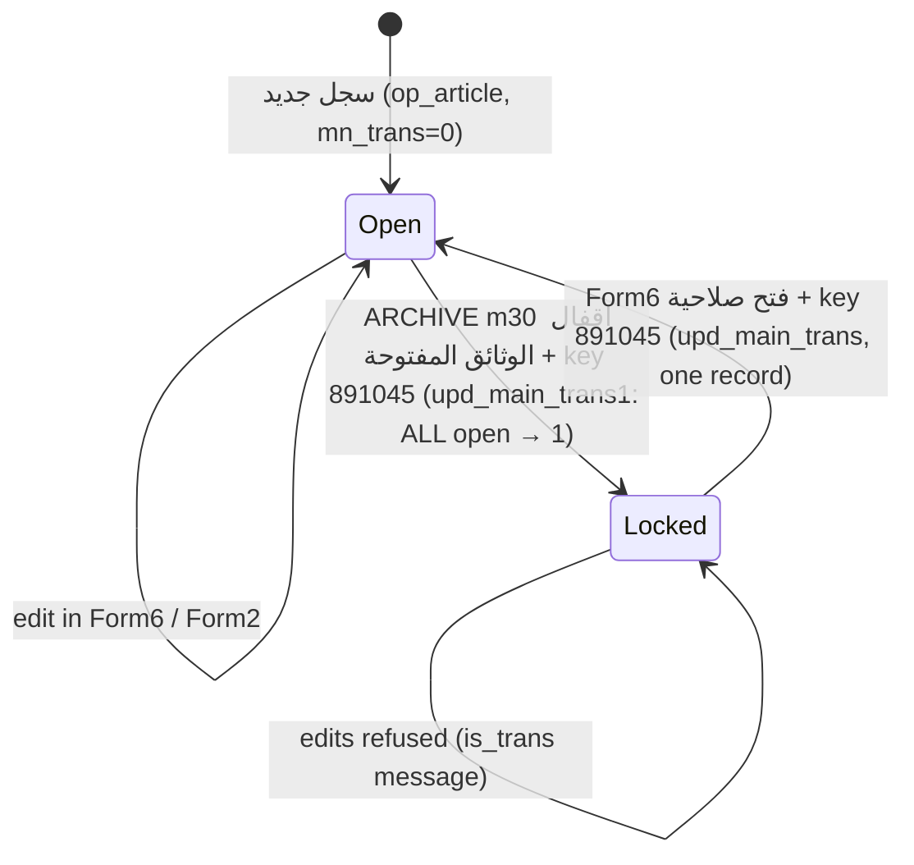
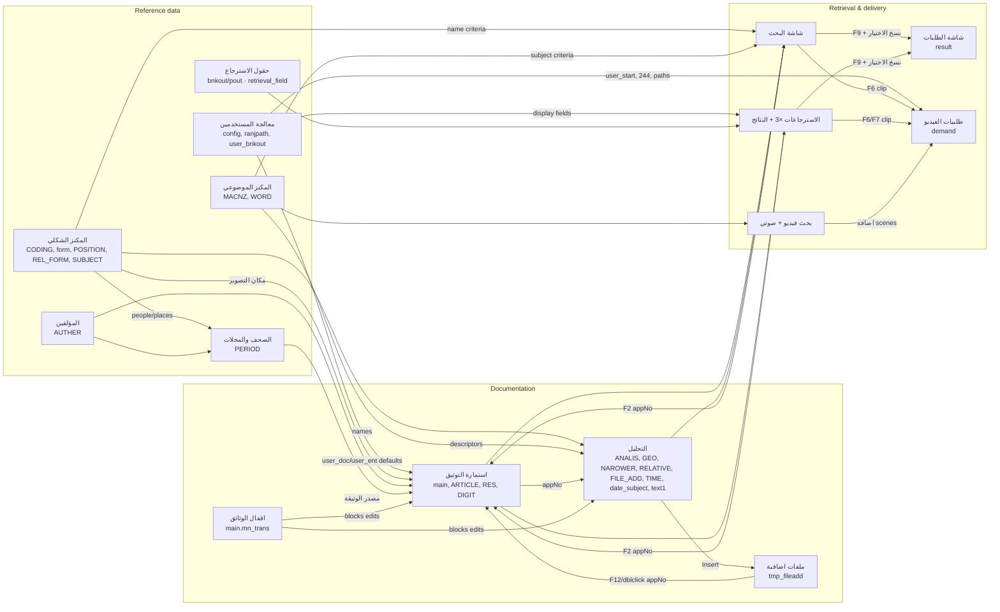

# Application Workflow Map — بنك المعلومات / Form Documenting Platform

Legacy VB6 + SQL Server (`macnz_saydhakim`) → Angular 21 + Spring Boot + PostgreSQL 16

Prepared 2026-10-11 as a pre-manual-testing study guide. This document is **investigation only**: no application code, configuration, migration or data was changed to produce it.

---

## 0. How to read this document

### 0.1 Path abbreviations

| Abbreviation | Real path (relative to `archive_system_migration_project/`) |
|---|---|
| `LEGACY/` | `Form Documenting Platform OLD Source code & DB DDL/macnz_saydhakim/macnz_saydhakim/` |
| `DDL:n` | `Form Documenting Platform OLD Source code & DB DDL/macnz_manar_ddl.sql`, line *n* (file is UTF‑16; line numbers are unchanged after conversion) |
| `FE/` | `Frontend-repo/src/app/` |
| `BE/` | `Backend-repo/src/main/java/com/startupstack/app/` |
| `MIG/` | `Backend-repo/src/main/resources/db/migration/` |
| `i18n` | `Frontend-repo/public/assets/i18n/ar.json` (Arabic labels the user sees) |

Legacy `.frm` files are Windows‑1256 text. Line numbers cited as `Form6.frm:3113` were read from a UTF‑8 conversion that keeps the same line breaks, so they match the original file.

**Forms are opened by their VB object name, not their file name.** That matters because several file names differ from the object name:

| File | VB object name (what code calls) |
|---|---|
| `PERIOD1.frm` | `PERIOD` (called as `period.Show` — VB is case-insensitive) |
| `user_inetrface.frm` | `user_interface` |
| `sort_from.frm` | `sort_form` |
| `from_report.frm` | `form_report` |
| `instit.frm` | `instit_F` |
| `users.frm` | `users` |

### 0.2 Evidence levels used throughout

Every claim about the migrated app is tagged with how it was established **in this session (2026‑10‑11)**:

| Tag | Meaning |
|---|---|
| **[CODE]** | Read in source code. Proves what the code *says*, not that it runs. |
| **[API]** | Read‑only HTTP call to the running Docker backend (`localhost:8081`, logged in as `admin`). Script: GET requests only. |
| **[DB]** | Read‑only `SELECT` against the Docker PostgreSQL (`macnz-manar-full-stack-db-1`). |
| **[TEST]** | Backend unit/integration test suite run in a clean copy (see §8.1). Tests use mocks; they prove service logic, not screens. |
| **[PRIOR]** | Claimed in an earlier session's notes or in a repository report (`PHASE_7_FINAL_VERIFICATION.md`, `PHASE_8_…`, `migration-audit-report-v4.md`, etc.). **Not re-verified here.** |
| **[NONE]** | Not verified at all. |

**No browser verification was performed in this session.** Nothing in this document proves a screen renders or behaves correctly in a browser. Treat every "Implemented" below as "the code exists", and confirm it during your manual testing.

### 0.3 The state of the environment you will test against

These facts change how manual testing will look, so read them first:

| Fact | Evidence | Consequence for testing |
|---|---|---|
| Docker stack running: frontend `:4200`, backend `:8081`, PostgreSQL `:5432` (container `macnz-manar-full-stack-db-1`), Redis, plus `legacy-oracle-mssql` (a SQL Server used in earlier sessions to run legacy procedures as an oracle). | `docker ps` | Backend/frontend images were built 2026‑10‑06 ≈21:25 (+03:00); the last commit (`893a6c7`) is 22:22 the same evening and the working tree is clean. The running build very likely matches HEAD but this is not proven byte-for-byte. |
| The database is almost empty: 24 `main`/`ARTICLE` records, 0 `PERIOD`, 12 `DIGIT`, 0 `RES`, 0 `ANALIS`, 3 `AUTHER`, 22 `MACNZ`, **12 `CODING` rows**, 5 `form`, 1 `result`, 0 `demand`, 0 `tmp_fileadd`, **1 user**. | [DB] | Most legacy workflows need reference data you do not have yet. |
| `CODING` only contains domains **03** (document type), **12** (frequency), **13** (acquisition) and **24** (file type: صوت/صورة/فيديو only). Domains **01** (documenter), **02** (data-entry location), **04** (author role), **29**, **34** (language), **32**/**33** (beneficiary entity / approving entity) are **empty**. | [API] `GET /api/lookups/coding?codePrefix=…` | الموثق, مدخل البيانات, اللغة, نوع المسؤولية البيانية, الجهة المستفيدة, الجهة الموافقة dropdowns will be empty. |
| Only one user: `ADM` / `admin`, level `A`, permission 255, `user_start` NULL, password already BCrypt. | [DB] | You cannot test user‑244 behaviour, `user_start=1` video operations, or non-admin restrictions without creating users. |
| `MACNZ` seed codes are 2/4/6 characters; legacy codes are 9 characters. | [DB], [PRIOR] | Level‑3 thesaurus drill-down and the analysis page's "level > 2" rule behave oddly on the seed. |
| 0 locked documents (`mn_trans = 1`). | [DB] | Lock/unlock flows cannot be exercised without data (and see Gap G1). |

---

## 1. Overall application architecture

### 1.1 Legacy (what you are replicating)

- **Type:** a single-user Windows desktop program (VB6). The shipped build is `LEGACY/project2.vbp` → `sot_new.exe`, startup form **`users`** (the login card). Other `.vbp` files in the folder are older or side builds (see §3.3).
- **Database access:** every form talks to SQL Server directly through RDO/ADO data controls (`MSRDC`, `Adodc`) and `cn.Execute "execute <proc> '…'"`. There is no middle tier. Most writes are stored procedures defined in the DDL; some forms also issue raw SQL or even **create stored procedures at runtime** (`create proc tmp_result as SELECT …`) to hold a query.
- **"Session" state lives in global variables** declared in `LEGACY/bok.bas`: the logged-in user (`box_user_no`, `box_user_name`, `box_user_start`, `box_user_ent`, `box_user_doc`, `m_cnf_path_pic`, `video_path`, …), and hand-off variables between screens (`m_bk_no` = record to open, `m_form_load` = how Form6 should open, `main_form` = which retrieval variant, `v_mch_*` = video clip to preview, `password1` = expected access key, `jad_print` = which report).
- **Screens pass data in two ways:** (1) set a global, then `.Show` the next form; (2) the opened form reads the opener's controls directly (e.g. `form2.frm:4266-4270` reads `Form6.m_mn_app_no.Text`).
- **Windows are modeless and stack.** When a screen opens another one, the first stays open underneath. "Returning" means closing the top window; the screen beneath still holds its state.

### 1.2 Migrated (what you are testing)

```
Browser (Angular SPA, :4200)
  └─ MainLayoutComponent (side menu + toolbar)          FE/layouts/main-layout/
       └─ <router-outlet> → lazy feature module → Component
             └─ Feature service (HttpClient)            FE/features/<feature>/services/
                   │  AuthInterceptor adds  Authorization: Bearer <JWT>
                   │  ErrorInterceptor: 401 → logout, 403/500 → snackbar
                   ▼
Spring Boot REST API (:8081, /api/...)
  JwtAuthenticationFilter → @Permission aspect (bitmask, admins always pass)
  Controller → Service → Repository (JPA or native SQL / NamedParameterJdbcTemplate)
                   ▼
PostgreSQL 16 database macnz_manar (schema = legacy tables + Flyway V1…V34)
```

| Legacy mechanism | Migrated mechanism |
|---|---|
| Global `box_user_*` variables | JWT claims (`sub`=user name, `perm`, `user_ent`, `user_doc`, `user_level`, `site_wly`) + `localStorage` `current_user` (`FE/core/services/token.service.ts`) |
| `m_bk_no` + `Form6.Show` | Route `/catalogue/new?appNo=<no>` (only from the additional-files window) or `/catalogue/<appNo>` (the analysis/detail page) |
| `main_form = 1/2/3` + `sort_form.Show` | Route data `scope: BANK / ADDITIONAL_FILES / PERIODICALS` on `/retrieval…` (`FE/features/retrieval/retrieval.module.ts`) |
| `sort_form` → `frm_result` hand-off via a runtime-created proc `tmp_resultN` | In-memory signal `RetrievalService.pendingSearch` (`FE/features/retrieval/services/retrieval.service.ts:18`) → POST `/api/retrieval/search` |
| `v_mch_*` globals + `new_vdpreview.Show` | Router navigation state `videoOrderPreload` (`unified-search.component.ts:220-233`) |
| Stacked modeless windows | Single-page routing: opening another screen **replaces** the current one (except the few MatDialogs). State of the previous screen is lost unless explicitly preserved. |
| Access-key "Frame3" prompt in ARCHIVE.frm | Route guards with `AccessKeyDialogComponent` (thesauri) or `adminGuard` (admin screens) |
| `box_user_no = "244"` hard-coded super-user | Property `queueAllUsersUserNo` / `writerUserNo` = "244" for video orders and subject thesaurus; **admin level `A`** elsewhere |

**Important architectural difference — the permission model.** Legacy VB code never reads `config.user_level` or `config.user_permition` (searched all `.frm`/`.bas`: no reference). Legacy access control is only: menu access keys (891045, 261015, a5g5), user number 244, and `user_start`. The migrated app adds a **new** model: user level `A` (admin) and a permission bitmask (`BE/shared/constants/PermissionConstants.java`: VIEW 1, CREATE 2, UPDATE 4, DELETE 8, ADMIN 16, REPORTS 32, EXPORT 64, BORROW 128) enforced by `@Permission` on write endpoints, with admins always passing. Expect a non-admin user with permission 0 to be blocked from saving in places legacy would allow.

---

## 2. Startup, login and the complete menu map

### 2.1 Legacy startup and login (`LEGACY/users.frm`, caption "بطاقة الدخول")

1. Program starts on `users` (`project2.vbp: Startup="users"`).
2. User types the **user number** (`config.user_no`, 3 chars). When the length reaches the field's limit, or on Enter, the form runs `exec SERCH_users '<no>'` (`users.frm:169-200`, `:202-226`; proc `DDL:8133` = `select config.* from config where user_no = @m_user_no`).
   - Not found → "هذا الرقم غير موجود !!!!", field cleared; after 5 misses the program closes (`:195-196`, `:218-219`).
   - Found → the form copies the user's row into globals: `box_user_no/name/password/start/pwd/ent/doc/cmpvd`, `m_cnf_path_pic` (archive root for scans/photos), `video_path`, `video_path1`, `box_company` (`:174-190`).
3. User types the password and presses Enter (`:229-275`). Compared in plain text with `config.user_password`.
   - Wrong → "كلمة المرور غير صحيحة !!!!"; after 4 wrong passwords the program closes (`:257-262`).
   - Right → opens the ODBC connection `cn`, unloads the login card and shows **`ARCHIVE`** (`:250-251`).
   - Esc at any time closes the program.
4. `USER_PWD` is loaded but never acted on: there is **no forced password change** in legacy.

### 2.2 Migrated login (`FE/features/auth/login/`, route `/auth/login`)

| Step | Code |
|---|---|
| User types **user name** (not number) and password; both required (reactive form validation). | `login.component.ts:18-35` |
| `AuthService.login()` → `POST /api/auth/login` `{username, password}` | `FE/core/services/auth.service.ts:16-31` → `BE/modules/users/controller/UserController.java:42` |
| `UserService.login`: `findByUserName`; BCrypt compare, or plain-text compare **and re-hash to BCrypt on success** (a DB write on first login of a legacy user). Wrong user/password → `IllegalArgumentException` → HTTP 401. | `BE/modules/users/service/UserService.java:89-117` |
| If `USER_PWD = 1` → returns a one-time token and the UI goes to `/auth/change-password` (migrated-only feature). | `UserService.java:109-113`, `login.component.ts:45-47` |
| Otherwise JWT stored in `localStorage.access_token`, user summary in `current_user`; navigates to **`/catalogue`** (catalogue list). | `token.service.ts`, `login.component.ts:48` |
| No attempt counter / lockout; no program exit. JWT lives 24 h (`application.yml: app.jwt.expiration-ms 86400000`). | — |
| Login page also links to `/public` (anonymous public search) — migrated-only. | `login.component.html` |

[API] Login as `admin`/`admin123` returned 200, level `A`, permission 255.

**Differences you will notice:** log in by *name* instead of *number*; no 5/4-attempt exit; a landing list page (`/catalogue`) that legacy never had (legacy showed an empty maximised window with the menu bar).

### 2.3 The legacy main window (`LEGACY/ARCHIVE.frm`, caption "برنامج بنك المعلومات")

`ARCHIVE` is a maximised window with only a menu bar (`ARCHIVE.frm:162-231`) and a hidden password panel **Frame3** (`:27-114`). Esc on the main window ends the program (`:387-391`).

**Frame3 access-key prompt** (`M6_Click :571-583`, `M2_Click :489-505`, `m30_Click :518-532`, `m31_Click :534-550`, `M32_Click :553-562`): the menu handler sets `password1` to the expected key, sets `M_PROG` to remember which action was requested, and shows Frame3 ("كلمة السر" + تنفبذ / الغاء الامر). Enter or تنفبذ (`Command20_Click :255-299`, `m_user_password_KeyPress :427-471`) compares the typed text with `password1`; on success it runs the remembered action, on failure it just hides the frame silently. Esc / الغاء الامر hides it.

### 2.4 Complete menu-to-screen map

| Legacy menu (top level) | Item (Arabic caption) | Shortcut | Access gate (legacy) | Legacy handler → screen | Migrated entry | Migrated gate |
|---|---|---|---|---|---|---|
| **التــرميــز** | المكنز الموضوعي | Ctrl+A | Frame3 key **891045** | `M6_Click :571` → `Form5` | Menu → `/subject-thesaurus`; Ctrl+A (outside text fields) | Route guard prompts key; server checks 891045 and issues grant header |
| | المكنز الشكلي | Ctrl+B | Frame3 key **891045** | `M2_Click :489` → `coding` | `/form-thesaurus`; Ctrl+B | Same pattern, `X-Form-Thesaurus-Access` |
| | المؤلفين ودور النشر | Ctrl+K | none | `m10_Click :473` → `Form8` | `/authors`; Ctrl+K | login only |
| | ملف بناء الاسترجاعات | — | `InputBox` key **a5g5** or **ش5ل5** | `m9_Click :630-642` → `Form4` | `/maintenance?tab=fields` | admin only (menu hidden + `adminGuard`); no key |
| | اقفال الوثائق المفتوحة | — | Frame3 key **891045** | `m30_Click :518` → runs `upd_main_trans1` ("انتهى الاقفال.......") | `/maintenance?tab=unlock` — **an unlock list, the opposite action** (Gap G1) | admin only; no key |
| | معالجة المستخدمين | — | Frame3 key **261015** | `m31_Click :534` → `config_users` | `/users` | admin only; no key |
| | معالجة حقول الاسترجاع | — | Frame3 key **261015** | `M32_Click :553` → `CAT_OUTFRM` | `/maintenance?tab=fields` (same target as ملف بناء الاسترجاعات) | admin only; no key |
| | نسخ قاعدة البيانات | — | none | `m33_Click :564-569` → `BACKUP DATABASE … d:\backup\…`, message "انتهى الاقفال......." | `/maintenance?tab=backup` | admin only |
| **المعالجات** | استمارة التوثيق | Ctrl+C | none | `M5_Click :586-593` (`m_form_load = 1`) → `Form6` | `/catalogue/new` | login only; **Ctrl+C not bound** |
| | الصحف والمجلات | Ctrl+D | none | `m8_Click :612-619` → `PERIOD` (PERIOD1.frm) | `/periodicals` | login only; **Ctrl+D not bound** |
| **الاسترجاعات** | الاسترجاع البياني لبنك المعلومات | Ctrl+S | none | `f2_Click :318` (`main_form = 1`) → `sort_form` | `/retrieval` (scope BANK) | login only; **Ctrl+S not bound** |
| | استرجاع الملفات الاضافية | Ctrl+E | none | `f3_Click :329` (`main_form = 2`) → `sort_form` | `/retrieval/additional-files` | **Ctrl+E not bound** |
| | طلبيات الفيديو | — | none | `f5_Click :352` → `new_vdpreview` | `/video-orders` | login; actions gated by user 244 / `user_start` |
| | استـرجـاع الصحف والمجلات | Ctrl+F | none | `f4_Click :341` (`main_form = 3`) → `sort_form` | `/retrieval/periodicals` | **Ctrl+F not bound** |
| *(no legacy item)* | — | — | — | — | **طلبات سحب الملفات الاضافية** → `/catalogue/files-retrieval` | migrated-only |
| **شاشة البحث** (top-level item) | — | — | none | `j1_Click :403` → `user_interface` | `/catalogue/search` (also the toolbar "manage_search" icon) | login |
| **شاشة الطلبات** (top-level item) | — | — | none | `j5_Click :411` → `f_result` | `/requests` | login |
| **شاشة البحث فيديو + صوتي** (top-level item) | — | — | none | `k1_Click :419` → `USER_INTERFACE1` | `/archive-search` | login |
| *(no legacy menu)* | **إضافات** group: الصور, الأشخاص, الإعارة, الأرشيف, المواقع, الرقمنة, التقارير, الصيانة | — | — | — | `/pictures`, `/persons`, `/borrowing`, `/archive`, `/sites`, `/digitization`, `/reports`, `/maintenance` | الصيانة admin-only |

Sources: legacy `LEGACY/ARCHIVE.frm:162-231` and handlers listed; migrated `FE/layouts/main-layout/main-layout.component.ts:45-92` (menu), `:186-199` (shortcuts), labels from `i18n` `NAV.*`.

**Legacy handlers with no menu item** (dead code in the shipped build — the forms they open are not even in `project2.vbp`): `m3` → `Form3`, `m7` → `picture_f`, `M77` → `find_charit`, `M88` → `istara`, `m12` → `Form11`, `m99` → `rec_charit`, `f6`/`f9`/`f10` → `sort_form` with `main_form` 7/5/6 (`ARCHIVE.frm:242-650`). These screens existed in older builds (`book.frm` is an older `ARCHIVE` with menus "المقالات", "الكتب والوقائق", "الـــدوريــــات", "حركة وصول الدوريات", "استرجاعات الكتــب"). Many of the migrated "إضافات" screens correspond to these unreachable forms.

**Migrated top toolbar** (`main-layout.component.html:101-124`): menu toggle, global search box (`app-global-search`), full-page search icon → `/catalogue/search`, user name, AR/EN language toggle, logout.

**URL-only migrated routes** (nothing in the menu or any screen links to them): `/books…`, `/articles…`, `/news…`, `/subjects`, `/video-orders/approvals…`, `/requests/:id/edit`, `/persons/staff/:id`, `/digitization/records/new`, `/digitization/demands/new`, `/digitization/results/new`.

### 2.5 How users open, leave and move between screens

| | Legacy | Migrated |
|---|---|---|
| Open | Menu click / shortcut, or a button/key in another screen | Side menu (hover flyout), shortcuts Ctrl+A/B/K only, links/keys in screens, or typing a URL |
| Leave | خروج / Esc (`Unload <form>`) returns to whatever window is underneath | خروج buttons almost always `router.navigate(['/catalogue'])` — i.e. to the catalogue **list**, not to the screen you came from |
| Return state | Previous window is still open with its record and search intact | Previous screen is re-created empty (exceptions noted per screen) |

---

## 3. Inventory of legacy and migrated screens

### 3.1 Shipped legacy screens (`project2.vbp`, 25 forms)

| # | File | VB name | Caption / purpose | Opened from | Migrated equivalent |
|---|---|---|---|---|---|
| 1 | users.frm | users | بطاقة الدخول — login | startup | `LoginComponent` `/auth/login` |
| 2 | ARCHIVE.frm | ARCHIVE | برنامج بنك المعلومات — main menu + key prompt | login | `MainLayoutComponent` + guards |
| 3 | Form5.frm | Form5 | مكنز الموضوعات (subject thesaurus, MACNZ) | menu m6 | `SubjectThesaurusComponent` `/subject-thesaurus` |
| 4 | coding.frm | coding | المكنز الشكلي (CODING, forms, positions, relations) | menu M2 | `FormThesaurusComponent` `/form-thesaurus` |
| 5 | Form8.frm | Form8 | ملف ترميز مسؤولي البيانات (AUTHER) | menu m10 | `AuthorCodingComponent` `/authors` |
| 6 | Form4.frm | Form4 | raw grids over `pout` and `bnkout` (retrieval field catalogue) | menu m9 | Maintenance tab "حقول الاسترجاع" |
| 7 | config_users.frm | config_users | users grid, `ranjpath` grid, per-user display fields | menu m31 | `UserListComponent` / `UserFormComponent` `/users` (partial) |
| 8 | CAT_OUTFRM.frm | CAT_OUTFRM | field categories for retrieval (`bnkout.out_cat`, `catogorie`) | menu M32 | Maintenance tab "حقول الاسترجاع" (partial) |
| 9 | Form6.frm | Form6 | ارشيف عام — استمارة التوثيق (main document form) | menu M5; F2 in search/results screens; additional-files window | `DocumentationFormComponent` `/catalogue/new` |
| 10 | form2.frm | Form2 | برنامج معالجة التحليل (analysis: descriptors & relations) | Form6 التحليل | `AnalysisPanelComponent` inside `/catalogue/:appNo` |
| 11 | vd_preview.frm | vd_preview | media preview with in/out time marks | Form6 / frm_result double-click on audio/video | none (Gap G9) |
| 12 | PERIOD1.frm | PERIOD | استمارة الدورية (periodicals master) | menu M8 | `PeriodicalFormComponent` `/periodicals` |
| 13 | sort_from.frm | sort_form | retrieval query builder (3 variants) | menus f2/f3/f4 | `GraphicalRetrievalComponent` `/retrieval[/additional-files\|/periodicals]` |
| 14 | frm_result.frm | frm_result | retrieval results grid | sort_form نتائج البحث | `RetrievalResultsComponent` `…/results` (partial) |
| 15 | from_report.frm | form_report | Crystal Reports viewer (report chosen by `jad_print`) | print buttons | `/reports` (generic, not report-specific) |
| 16 | new_vdpreview.frm | new_vdpreview | طلبيات الفيديو (video scene order queue) | menu f5; F6 in search screens | `VideoOrderQueueComponent` `/video-orders` |
| 17 | progress.frm | progress | modal progress for video export | new_vdpreview start | job polling in queue component |
| 18 | user_inetrface.frm | user_interface | شاشة البحث (22-criteria search + file export + request logging) | top item j1 | `UnifiedSearchComponent` `/catalogue/search` |
| 19 | f_result.frm | f_result | ارشيف طلبات الاستفادة (usage requests) | top item j5 | `UsageRequestListComponent` `/requests` |
| 20 | USER_INTERFACE1.frm | USER_INTERFACE1 | برنامج الارشيف — video+audio search, scene ordering | top item k1 | `ArchiveSearchCockpitComponent` `/archive-search` |
| 21 | tmp_file.frm | tmp_file | ملفات اضافية للادخال (`tmp_fileadd` intake list) | Form2 "ملفات اضافية للترميز"; coding "الملفات الاضافية للادخال" | `AdditionalFilesComponent` (dialog from form thesaurus) **and** a simpler `TempFilesComponent` inside the analysis page |
| 22 | person_f.frm | person_f | استمارة الشخصية | coding F5 on a type‑01 name | not wired (message) |
| 23 | instit.frm | instit_F | استمارة مؤسسة | coding F5 on a type‑03 name | not wired; its procs/table are missing from the DDL (§9.3) |
| 24 | correct.frm | correct | renumbering utilities | **never opened** (no `.Show` anywhere) | Maintenance "إعادة الترقيم" tab (migrated choice) |
| 25 | corect1.frm | corect1 | `upd_digit_high` utility | **never opened** | Maintenance "نسخ إلى الأرشيف"/"ربط الملفات" (migrated choice) |

### 3.2 Migrated screens (all routes)

| Route | Component | Legacy origin | How reached |
|---|---|---|---|
| `/auth/login`, `/auth/change-password` | `LoginComponent`, `ChangePasswordComponent` | users.frm (change-password is new) | start / redirect |
| `/public` | `PublicSearchComponent` | none | login page link (no login needed) |
| `/catalogue` | `CatalogueListComponent` | none (new landing list) | default after login; every خروج |
| `/catalogue/new[?appNo=]` | `DocumentationFormComponent` | Form6 | menu استمارة التوثيق; additional-files window |
| `/catalogue/:appNo` | `CatalogueDetailComponent` + `AnalysisPanelComponent` + `TempFilesComponent` | Form2 (+ tmp_file) | التحليل; open-record from lists/search/retrieval |
| `/catalogue/search` | `UnifiedSearchComponent` | user_inetrface | menu شاشة البحث; toolbar icon |
| `/catalogue/files-retrieval` | `FilesRetrievalComponent` | none (tmp_fileadd list) | menu طلبات سحب الملفات الاضافية |
| `/periodicals[/new\|/:perNo]` | `PeriodicalFormComponent` | PERIOD1 | menu |
| `/retrieval`, `/retrieval/additional-files`, `/retrieval/periodicals` (+ `/results`) | `GraphicalRetrievalComponent`, `RetrievalResultsComponent` | sort_form / frm_result | menu |
| `/video-orders` | `VideoOrderQueueComponent` | new_vdpreview | menu; F6 from search screen |
| `/video-orders/approvals…` | `VideoOrderListComponent/FormComponent` | none (table `video_order`, invented) | URL only |
| `/requests`, `/requests/:id/edit` | `UsageRequestListComponent`, `UsageRequestFormComponent` | f_result | menu / URL only |
| `/archive-search` | `ArchiveSearchCockpitComponent` | USER_INTERFACE1 | menu |
| `/subject-thesaurus` | `SubjectThesaurusComponent` | Form5 | menu, Ctrl+A |
| `/form-thesaurus` | `FormThesaurusComponent` (+ dialog `AdditionalFilesComponent`) | coding (+ tmp_file) | menu, Ctrl+B |
| `/authors` | `AuthorCodingComponent` | Form8 | menu, Ctrl+K |
| `/users…` | `UserListComponent`, `UserFormComponent` | config_users | menu (admin) |
| `/maintenance?tab=…` | `MaintenanceShellComponent` (tabs: إعادة الترقيم, نسخ إلى الأرشيف, ربط الملفات, النسخ الاحتياطي, فتح قفل الوثائق, حقول الاسترجاع) | Form4, CAT_OUTFRM, m30, m33, correct/corect1 | menu (admin) |
| `/pictures…`, `/persons…`, `/borrowing…`, `/archive…`, `/sites…`, `/digitization…`, `/reports…` | various | picture_f, person/PERSON, istara, charit/find_charit, (sites/posts/forms), digitization tables, Crystal reports — **none reachable in the shipped legacy build** | إضافات group |
| `/books…`, `/articles…`, `/news…`, `/subjects` | various | older builds (book.frm menus, sort_news) / invented | URL only |

### 3.3 Legacy files that are not part of the shipped build

`Form1.frm`, `Form3.frm`, `form7.frm`, `form9.frm`, `Form10.frm` (explicitly excluded in `CLAUDE.md`), `PERIOD2.frm`, `period.frm`, `opr_period.frm`, `trs_period.frm`, `book.frm`, `book1.frm`, `charit.frm`, `find_charit.frm`, `istara.frm`, `person.frm`, `picture_f.frm`, `macnz.frm`, `m1/m2/m3.frm`, `frm_res2.frm`, `frm_res3.frm`, `frm_view.frm`, `end_user.frm`, `order_bnkout.frm`, `sort_news.frm`, `user1.frm`, `Copy of user_inetrface.frm`, `vd_preview`'s older siblings. They belong to `Project1.vbp` (macnz.exe), `bbb.vbp`, `macnz1.vbp`, `sort_news.vbp`, `sort_prog.vbp`. They document older behaviour but were **not reachable** from the shipped `sot_new.exe` menu. Use them only as secondary evidence.

---

## 4. Detailed workflow of every screen

Each screen follows the same layout: **Legacy behaviour** (the authority) → **Migrated implementation** → **Differences**. Button tables list *every* command button the legacy form has; hidden confirmation frames are described with the button that opens them.

Common legacy conventions you will see everywhere:

- **Enter moves to the next field**; on certain "last" fields Enter also saves.
- **Lookups** are a text box + a hidden list (`DBList`). **F8** = search names that *start with* the text; **F9** = search names *containing a word*; **Enter** picks the highlighted item; **Esc** closes the list. The list shows a *name* (`ListField`) but stores a *code* (`BoundColumn`).
- **Coded values** live in `CODING` with a 4-character `SUB_CODE` = 2‑char *domain* + 2‑char *value*. Combos are bound to the full 4‑char code, but only the last 2 chars are saved (`Mid(x.BoundText, 3, 2)`); on load the domain is put back in front (`"01" + MN_APP_DOC`). §6.2 lists every domain.
- **Deletes ask** "(ن / ك)" — the user must type `ن` (or `y`/`Y`) to confirm.
- **`is_trans(box_mn_trans)`** (`bok.bas`) blocks edits on a locked document with "لاتستطيع التعدل او الالغاء ....لان الوثيقة مقفلة."

### 4.1 Login — `users.frm` → `/auth/login`

Covered in §2.1–2.2. **Status:** Implemented with deliberate differences (name instead of number, no attempt limit, forced password change added, BCrypt). [CODE] [API]

### 4.2 Main window — `ARCHIVE.frm` → `MainLayoutComponent`

Covered in §2.3–2.5. **Differences:** keys 261015 and a5g5 are replaced by an admin-level check; 891045 is kept only for the two thesauri; legacy shortcuts Ctrl+C/D/S/E/F are not bound; Esc no longer closes the application. [CODE]

### 4.3 المكنز الموضوعي (subject thesaurus) — `Form5.frm` → `/subject-thesaurus`

**Purpose.** Maintain the subject descriptor hierarchy (`MACNZ`, 3 levels). These descriptors are what the analysis page (Form2) attaches to documents, and what search/retrieval screens search by "الموضوع / الاضيق / المترابط".

**Open.** Menu Ctrl+A → Frame3 key 891045 → `Form5` maximised.

**Display.** Three lists side by side: المستوى الاول / الثاني / الثالث (`macnz1/2/3`, from `proc_macnz1` and `proc_macnz`), plus "الرمز" (code) and "الواصفة" (description) boxes.

| Control | Legacy behaviour (`Form5.frm`) | DB |
|---|---|---|
| اضافة (insert) / Insert key | Only if `box_user_no = "244"` (`:654-693`). Level‑3 add reserves a code: `OP_macnz` + `max_macnz` (`:680-682`). | MACNZ |
| تعديل (F2) | Puts the selected term into edit mode (`:695-719`). | — |
| تسجيل | 244 only. Insert (`insr_macnz`) or update (`upd_macnz`), then `div_word` splits the description into words and writes them to `WORD` (`:721-830`, `:573-627`). | MACNZ, WORD |
| الغاء (Delete) | 244 only; prompt "(ن/ك)"; `del_macnz` (`:832-882`). | MACNZ |
| بحث (F10) / F8 / F9 | Prefix search (`serh_macnz`) on all three lists; word search (`serh_wrdmacnz`) (`:884-925`, `:1175-1242`). | read MACNZ, WORD |
| Double-click/Enter on a level | Drills into the next level (`proc_macnz`) (`:939-1104`). | read |
| خروج | `Unload Form5`. | — |

**Migrated.** `FE/features/subject-thesaurus/subject-thesaurus/subject-thesaurus.component.ts` + `thesaurus-list` → `SubjectThesaurusService` (FE) → `/api/subject-thesaurus/*` (`SubjectThesaurusController`: `POST /access`, `GET /context`, `GET/POST/PUT/DELETE /terms`, `POST /terms/level3-code`) → `SubjectThesaurusService` + `SubjectThesaurusRepository` (native SQL replicating the procs; Arabic SQL‑Server collation re-implemented in `BE/shared/collation/LegacyCollation.java`). Key enforced server-side (`application.yml app.subject-thesaurus.access-key = 891045`), 244 gate kept (`SubjectThesaurusProperties.writerUserNo`).

**Differences / notes.** Writes through the older `/api/lookups/subjects` endpoints bypass the key and the 244 gate (only used by the URL-only `/subjects` page). Seed MACNZ codes are not in the legacy 9‑char format. [CODE] [API: `/context` without key → 403 "يجب ادخال كلمة السر لفتح المكنز الموضوعي"] [PRIOR: oracle comparison 70/70 against real legacy procs]

### 4.4 المكنز الشكلي (form thesaurus) — `coding.frm` → `/form-thesaurus`

**Purpose.** Maintain the "formal" vocabulary: the two-level classification of names (`CODING` codes `10xx`), the **names** themselves (`form`: persons, institutions, places… each has `SUB_TYP` + `SUB_NO`), countries, **positions** held by persons (`POSITION`), and relations between names (**الربط الشكلي** → `REL_FORM`) and between a name and subjects (**الربط الموضوعي** → `SUBJECT`), each with start/end dates.

**Open.** Ctrl+B → Frame3 key 891045.

**Display.** المستوى الاول / الثاني lists (CODING), الدول (countries, view `pay_form`), الاسماء (names of the selected type & country, `nam_form`), المناصب (positions, `proc_pos`, only for type `01` = person), الربط الشكلي and الربط الموضوعي lists for a relation number (`m_rel`) with تقدم / تراجع, a picker list (DBList8) and a dates panel (تاريخ البداية / النهاية).

| Control | Legacy behaviour (`coding.frm`) | DB |
|---|---|---|
| اضافة (INSERT) | New code/name/position; names get a number from `OP_FORM`/`max_form`, then `insr_form` (`:2170-2248`). | CODING, form |
| تعديل (F2) | Loads the selected item for editing; duplicate check with `find_coding`/`find_form` → "هذا الرقم تابع لاستمارة اخرى!!!!!" (`:2250-2305`, `:2099-2168`). | read |
| تسجيل | `insr_form`/`upd_form`/`insr_pos`/`upd_coding`/`upd_position`/`upd_rfl_dte`/`upd_sub_dte`, plus word index (`div_word` → `WORD`) (`:2307-2535`). | CODING, form, POSITION, REL_FORM, SUBJECT, WORD |
| الغاء (DELETE) | "(ن/ك)" → `del_coding`/`del_form`/`del_position`/`del_rel_form`/`del_subject` (`:2537-2641`). | same |
| بحث | `serh_form` / `serh1_form` (`:1445-1484`). | read |
| تقدم / تراجع | Step the relation number `m_rel` and reload `rel_form_proc` / `subject_proc` (`:1494-1513`). | read |
| DBList8 Enter/double-click | Adds a relation `insr_rel_form` / `insr_subject` (`:1913-2048`). | REL_FORM, SUBJECT |
| **F5 on a name** | Type `01` → opens **`person_f`** (person card); type `03` → opens **`instit_F`** (institution card), passing `m_prsno` (= type+number) and `m_prs_sub_name` (`:1646-1667`). | PERSON / (institution table absent from DDL) |
| الملفات الاضافية للادخال | Opens **`tmp_file`** (§4.22) (`:1490-1492`). | — |
| خروج | `Unload Me`. | — |

**Migrated.** `FE/features/form-thesaurus/form-thesaurus/form-thesaurus.component.ts` (+ `coding-list`, dialog `additional-files`) → `FormThesaurusService` (FE) → `/api/form-thesaurus/*` (`FormThesaurusController`: access, context, coding, forms, words, positions, relations/forms, relations/subjects, macnz, additional-files/*) → `FormThesaurusService`, `AdditionalFilesService`, repositories using `NamedParameterJdbcTemplate`. Migration `V33` removed constraints that legacy did not have.

**Differences.** F5 → person/institution cards not migrated (message instead) [PRIOR]. "تسجيل" of level 1/2 without a pending add (legacy overwrote an arbitrary row) not reproduced. [CODE] [API: `/context` without key → 403] [PRIOR: oracle 50/50]

### 4.5 المؤلفين ودور النشر (authors & publishers) — `Form8.frm` → `/authors`

**Purpose.** Maintain `AUTHER` (number + name). Authors are attached to documents in Form6's "جدول المسؤولية البيانية" and to periodicals as publisher (دار النشر).

**Open.** Ctrl+K, no key.

| Control | Legacy (`Form8.frm`) | DB |
|---|---|---|
| اضافة | Prepares a new number = last row of the *current list* + 1 (`:266-284`). | — |
| تعديل | Edit selected (`:286-302`). | — |
| تسجيل | `insr_auther` / `upd_auther` (`:304-344`). | AUTHER |
| الغاء | "هل تريد الغاء المقالة(ن/ك)" (yes, the legacy text says *المقالة*) → `del_auther` (`:346-371`). | AUTHER |
| بحث (F10) / بحث كلمة | `serh_auther1` (prefix) / `serh_auther2` (word) (`:373-423`, `:447-478`). | read |
| Enter in name | Prefix duplicate check → "هذا الاسم موجود سابقا...!!!" (`:480-549`). | read |
| خروج | `Unload Form8`. | — |

**Migrated.** `FE/features/authors/author-coding/author-coding.component.ts` → `AuthorCodingService` → `/api/authors/coding` (GET/POST/PUT `{number}`/DELETE `{number}`) → `AuthorCodingService`/`AuthorCodingRepository` (native SQL). The older `/api/authors` CRUD still feeds autocompletes elsewhere.

**Differences.** PostgreSQL has `UNIQUE(AUT_NO)` and foreign keys from `RES`/`BOOK`, so a duplicate number or deleting an author still used by a document returns a 409 message (legacy had no constraint and silently orphaned links). Sort order uses PostgreSQL collation. [CODE] [API: list returned 3 rows] [PRIOR]

### 4.6 ملف بناء الاسترجاعات — `Form4.frm` → Maintenance › حقول الاسترجاع

**Legacy.** Key `a5g5`/`ش5ل5` via `InputBox` (`ARCHIVE.frm:630-642`). `Form4` is just two bound data grids over the retrieval catalogues `pout` (by `out_ist`) and `bnkout` (by `out_num`) (`Form4.frm:14-31`, `:32-126`); editing happens directly in the grids. Its text-box handlers only show debug messages ("f1", "f10", "13", "delete").

**Migrated.** Same tab as §4.9. The migrated catalogue is the new table `retrieval_field` (41 rows [DB]), not `bnkout`/`pout`. CRUD via `RetrievalFieldDialogComponent` → `/api/retrieval-fields` (`RetrievalFieldController` → `RetrievalFieldService` → `RetrievalFieldRepository`). Admin only.

### 4.7 اقفال الوثائق المفتوحة (lock open documents) — action `m30` → Maintenance › فتح قفل الوثائق

**Legacy.** After key 891045, runs `execute upd_main_trans1` (`ARCHIVE.frm:278-281`, `:447-450`; proc `DDL:10900` = `update main set mn_trans = 1 where mn_trans = 0`) and shows "انتهى الاقفال.......". **Every unlocked document becomes locked.** This is how finished documentation work is frozen; afterwards Form6/Form2 refuse edits until a single document is reopened with "فتح صلاحية" (§4.11).

**Migrated.** The menu item with the same Arabic label opens the **unlock** tab: a list of locked documents (`GET /api/catalogue/locked`) with a per-row "فتح القفل" button (`PATCH /api/catalogue/{appNo}/unlock`, admin only). **No endpoint or screen sets `mn_trans = 1`** (searched all backend and frontend code). See Gap **G1**. [CODE] [API: locked list = 0 rows]

### 4.8 معالجة المستخدمين — `config_users.frm` → `/users`

**Legacy.** Key 261015. Three editable grids (AllowAddNew/Update/Delete):
1. `config` — every user column (`user_no, user_name, user_password, user_cnf_path, user_start, …`) (`config_users.frm:15`).
2. `ranjpath` — which video number ranges live on which path (من رقم video / الى رقم video / المسار / type) (`:312`). Used by every video player to locate files.
3. Per-user display fields for retrieval (`view_user_bnkout`) for the "نوع الاستمارة" chosen in `m_ist_no` (default `3801`) (`:484`, `:897-899`).

Keys on the users grid: **double-click** = show that user's display fields (`proc_user_bnkout` / `proc_user_pout`) (`:827-836`); **F4** = if the user has none yet, copy every eligible field from `bnkout` (or `pout` for other form types) into `user_bnkout` (`insr_user_bnkout`) (`:838-876`); **F3** = "هل تريد الغاء حقول العرض (ن/ك)" → `del_user_bnkout` (`:877-886`; proc missing from DDL).

**Why it matters:** a new user cannot use the retrieval screens until F4 has initialised their display fields (sort_form reads only `view_user_bnkout` rows of `box_user_no`).

**Migrated.** `UserListComponent` / `UserFormComponent` → `/api/users` (`UserController` → `UserService` → `UserRepository`, table `config`). Form fields cover every `config` column plus level/permission. `adminGuard` on all three routes.

**Differences.** No `ranjpath` editor in the UI (backend has `/api/admin/media-ranges`, no frontend caller). No F4/F3 equivalent: the migrated retrieval stores per-user marks in the new table `retrieval_user_field`, created on demand when the user toggles a field. [CODE] [API: users list = 1]

### 4.9 معالجة حقول الاسترجاع — `CAT_OUTFRM.frm` → Maintenance › حقول الاسترجاع

**Legacy.** Key 261015. Grid of `bnkout` fields with sequence, name, display order (`OUT_INDX`), question order (`OUT_INDX3`) and category (`OUT_CAT`); check boxes حقول العرض / اسئلة الاسترجاع filter the grid (`CAT_OUTFRM.frm:442-479`). Space on a row → pick a category → `upd_OUT_CAT` (`:489-518`). Second grid = categories (`catogorie`) for a chosen CODING domain‑37 value; Insert adds one (`insr_catogorie`) (`:520-536`). These categories feed sort_form's "لوائح لحقول العرض" combo.

**Migrated.** Same admin tab as §4.6, over `retrieval_field` (has a category column). No separate category table editor. [CODE]

### 4.10 نسخ قاعدة البيانات — `m33` → Maintenance › النسخ الاحتياطي

**Legacy.** Executes `BACKUP DATABASE [macnz_manar] TO DISK = N'd:\backup\backup_macnz_manar' …` and shows "انتهى الاقفال......." (sic) (`ARCHIVE.frm:564-569`). No key.

**Migrated.** `POST /api/admin/backup`, list via `GET /api/admin/backup` (`AdminController` → `AdminService` / `BE/shared/backup`), directory `app.backup.directory` (default `./backups` inside the backend container). Admin only. [CODE] [API: list = 0 backups]

### 4.11 استمارة التوثيق (documentation form) — `Form6.frm` → `/catalogue/new`

This is the **central screen** of the application: every document record is created here.

**Purpose.** Create and maintain one documentation record: a row in `main` (title, dates, documenter, abstract, lock flag) plus a 1:1 row in `ARTICLE` (source periodical, issue, pages, language…), with two child grids: responsible persons (`RES`) and linked digital files (`DIGIT`).

**Open.**
- Menu استمارة التوثيق / Ctrl+C: `m_form_load = 1` → opens empty (`ARCHIVE.frm:586-593`, `Form6.frm:4189-4206`).
- From شاشة البحث / frm_result **F2** on a row whose number starts with `ق`, or from `tmp_file` double-click/F12: sets `m_bk_no` and `m_form_load = 2` → `Form_Activate` loads that record with `SERCH_main` and `display_fld` (`Form6.frm:4200-4204`).

**Fields (header).**

| Label | Control | Stored in | Lookup source |
|---|---|---|---|
| الرقم | `m_mn_app_no` (7 chars, `ق` + 6 digits) | `main.MN_APP_NO` = `ARTICLE.ART_APP_NO` | allocated by `op_article` |
| تاريخ الادخال | `m_mn_ent_dte` | `MN_ENT_DTE` | — (defaults to today on new) |
| مدخل البيانات | combo `m_mn_data_en` | `MN_DATA_EN` (2 chars) | CODING `02xx` (`view_coding3`) — default user's `user_ent` |
| الموثق | combo `m_mn_app_doc` | `MN_APP_DOC` | CODING `01xx` (`view_coding2`) — default user's `user_doc` |
| مصدر الوثيقة | combo `m_art_per_no` (shows `PER_PER_NA`) | `ARTICLE.ART_PER_NO` (number) | `PERIOD` (`select * from period order by per_per_na`) |
| تاريخ الوثيقة | `m_art_dte` | `ART_DTE` | — |
| مصدر الترجمة | combo `m_art_per1` | `ART_PER1` | `PERIOD` |
| تاريخ الترجمة | `m_art_dte1` | `ART_DTE1` | — |
| العنوان الفعلي | `m_mn_act_ttl` (125) | `MN_ACT_TTL` | — |
| العنوان الثانوي | `m_mn_add_ttl` (125) | `MN_ADD_TTL` | — |
| نوع الوثيقة | combo `m_art_sub_ty` | `ART_SUB_TY` | CODING `03xx` (`VIEW_coding`) |
| اللغة | combo `m_art_lang` | `ART_LANG1` | CODING `34xx` (default `3401`) |
| عدد الصفحات | `m_art_pg_no` | `ART_PG_NO` | — |
| رقم العدد | `m_art_no` | `ART_NO` | — |
| طبيعة الوثيقة (ع علني / س سري) | `m_mn_typ` | `MN_TYP` | — (default `ع`) |
| المستخلص | `M_MN_RESULT` (2000) | `MN_RESULT` | — |
| يوجد نص / لا يوجد نص | label `tit_istext` | read from `text1` via `serh_text2` | — |

**Grid 1 — جدول المسؤولية البيانية (`DataGrid2`, `RES`).** Columns: نوع المسؤولية البيانية (`RES_APP_TY`, CODING `04xx`), المسؤول البياني (`AUTHER.AUT_NAM`). Loaded by `res_proc1` (`DDL:7992`, joins `'04' + RES_APP_TY`). Keys (`Form6.frm:3727-3799`): **Space** on the type column → list of role types (DBList2, `upd_res1`); on the name column → author list (DBList1; **F8** opens a search box, `serh_auther`; Enter → `upd_res`); **Insert** or **i** → `insr_res` (new link); **Delete** → `del_res1`.

**Grid 2 — جدول ربط الوثائق الرقمية بالبيانات (`DataGrid1`, `DIGIT`).** Loaded by `rel_digit_proc` (`DDL:7883`). 17 columns: التسلسل, نوع الملف high, شكل الوثيقة (`DIG_TYP1`, CODING 24), نوع الملف (extension), رقم digital (`DIG_DIG_NO`), نوع المادة (CODING 29), حجم الملف, من/الى (ساعة/دقيقة/ثانية), الارشيف الجديد/القديم, نوع الشريط (CODING 26), مكان التصوير/النشر (`form` name). Grid is read-only when the record is locked (`:2729-2733`). Keys (`:3520-3722`):

| Key | Legacy effect |
|---|---|
| **Insert** | `insr_digit1(appNo, nextSerial)` — adds an empty row. |
| **Space** on column 2 (شكل الوثيقة) | pick from CODING 24 → `upd_rel_digit` (`DIG_TYP1`). |
| Space on column 5 (نوع المادة) | CODING 29 → `upd_rel_digit3` (`DIG_TYPMAT`). |
| Space on column 15 (نوع الشريط) | CODING 26 → `upd_rel_digit1`. |
| Space on column 16 (مكان التصوير/النشر) | type-to-search names (`serh_allform`) → `upd_rel_digit2` (`DIG_GEOCHRT`). |
| Space on column 4 (رقم digital) when empty and type ≠ 04 | **file chooser** → `op_digit` allocates the next 6-digit number for that type, then **copies the file** into `<user_cnf_path>\scan|waves|photos|private\NN\NN\<number>.<ext>` and shows "copy the number … to archive" (or "هذا الملف مدخل سابقا"). |
| **F5** | `op_digit(appNo, serial)` (number allocation without copying). |
| **Delete** | Frame2 "هل تريد الغاء هذه السجل (ن / ك)" → refuses if the file still exists in the archive tree ("هذا الملف موجود في الشجرة يجب الغاءه اولا منها"), else `del_digit` (`:3037-3090`). |
| **Double-click** | types 01/03/05: open the archived file with Windows (`OpenDoc`) or "هذا الملف غير موجود في الارشيف....<path>"; types 02/04: open **`vd_preview`** player positioned at the row's from/to times (`:3425-3518`). |

**Toolbar buttons.**

| Button | Legacy behaviour | DB |
|---|---|---|
| سجل جديد | `op_article` (`DDL:7229`): `MAX(main number)+1`, **inserts empty `ARTICLE` and `main` rows immediately** (`mn_trans = 0`), loads it; defaults date = today, documenter/data-entry = user's `user_doc`/`user_ent`, language `3401`, nature `ع` (`:3113-3153`). | INSERT main, ARTICLE |
| تسجيل | If locked → is_trans message. Else `upd_main` (`DDL:10814`) + `upd_article2` (`DDL:10218`). Empty number → " رقم الاستمارة فارغ يجب ان تضغط على سجل جديد" (`:2799-2845`). **Enter on العنوان الثانوي or نوع الوثيقة also saves** (`:4050-4093`, `:4465-4516`). **Esc in المستخلص saves only the abstract** via `upd_mn_result` (`:4272-4285`; proc missing from DDL). | UPDATE main, ARTICLE |
| سابق / لاحق | Walk numbers −1 / +1 (`ق` + 6 digits) until an existing record is found; at the end "لا يوجد استمارة لاحقة"; before the first wraps to the last (`:3303-3362`). | read |
| الاخير | Load `max_article` (`:3174-3184`). | read |
| بحث | Frame4 "رقم الاستمارة" → `SERCH_main` → load or "لا يوجد استمارة لهذا الرقم !!!!" (`:2908-2923`). | read |
| البحث بالعنوان | InputBox "ادخل العنوان الفعلي :" → `SERH_main` prefix search (`DDL:8504`) → pick from list DBList3 (`:3382-3404`, `:4178-4187`). | read |
| الغــاء | If locked → message. Frame1 "هل تريد الغاء هذه الاستمارة (ن / ك)" → deletes `main`, `ARTICLE`, `RES`, `DIGIT`, `ANALIS`, `GEO`, `RELATIVE`, `NAROWER`, `FILE_ADD` rows of this number, clears the form (`:2853-2906`). | DELETE ×9 |
| فتح صلاحية | Frame3 shows "الوثيقة مقفلة/مفتوحة" and asks a password; **891045** → `upd_main_trans` (`mn_trans = 0`), else "كلمة السر خطا....؟" (`:3092-3111`, `:3155-3168`, `:4338-4354`). | UPDATE main |
| التحليل | New record (`mod_typ = 1`): saves then opens **Form2** directly. Existing record: Frame5 "هل تريد الانتقال الى الصفحة الثانية ؟" → مع تسجيل (save then open) / بدون تسجيل (open) / الغاء الامر (`:3222-3301`, `:2951-3020`). | UPDATE main, ARTICLE |
| خــروج | `Unload Form6` (`:3406`). | — |

Typing a number in الرقم while in new mode and pressing Enter checks it is unused ("هذا الرقم تابع لاستمارة اخرى!!!!!") (`:4404-4419`).

**Migrated implementation.**

| Layer | Files / endpoints |
|---|---|
| Component | `FE/features/catalogue/documentation-form/documentation-form.component.ts/.html` + dialogs (`confirm-prompt`, `password-gate`, `goto-record`, `page2-prompt`, `search-by-title`), child `digital-files-grid` (+ `digit-record-dialog`) |
| FE services | `DocumentationFormService` (`/api/articles…`), `CatalogueService` (`/api/catalogue/{appNo}/authors`, `/text1`, `/unlock`), `AutocompleteService` (`/api/lookups/coding?codePrefix=`, periodicals, authors), `DigitizationService` (`/api/digitization/records…`) |
| Endpoints | `POST /api/articles/next` (سجل جديد), `GET /api/articles/{appNo}`, `PUT /api/articles/{appNo}/documentation` (تسجيل), `DELETE /api/articles/{appNo}` (الغاء), `GET /api/articles?page=0&size=200&sort=appNo,…` (سابق/لاحق/الاخير), `GET /api/articles?title=` (البحث بالعنوان), `PATCH /api/catalogue/{appNo}/unlock` (فتح صلاحية), `GET/POST/PUT/DELETE /api/catalogue/{appNo}/authors…`, `GET/POST/PUT/DELETE /api/digitization/records…` |
| Backend | `ArticleController` → `ArticleService` (`createNext` with advisory lock, `updateDocumentationForm` = upd_main+upd_article2 only, `delete` = legacy child order) → `ArticleRepository`, `CatalogueRepository`; `CatalogueController` → `CatalogueService.unlockRecord`; `DescriptorController` → `DescriptorService` (authors = `RES`); `DigitizationController` → `DigitizationService` → `DigitRepository` |
| Tables | `main`, `"ARTICLE"`, `"RES"`, `"AUTHER"`, `"DIGIT"`, `"CODING"`, `"PERIOD"`, `text1`; delete also `"ANALIS"`, `"GEO"`, `"RELATIVE"`, `"NAROWER"`, `"FILE_ADD"` |
| Keys | F5 = add digital-file dialog; F8 = open author input (`documentation-form.component.ts:309-326`). Ctrl+C not bound. |

**Differences (Form6).**

| # | Legacy | Migrated | Evidence |
|---|---|---|---|
| D6.1 | Author role list = CODING domain **04** (`coding5` = `VIEW_CODING5`, `DDL:3167`; `res_proc1` joins `'04'+RES_APP_TY`) | Loads domain **29** for نوع المسؤولية (`documentation-form.component.ts:86-91, 177-186`); the code comment admits it is inferred. Likely wrong → **Gap G2**. | [CODE] |
| D6.2 | فتح صلاحية requires key **891045** (any user) | Dialog accepts **any non-empty text**; backend requires admin level `A` instead (`password-gate-dialog.component.ts:24-27`; `CatalogueService.java:182-193`) → **Gap G3**. | [CODE] |
| D6.3 | Save is refused when locked (`is_trans`) | `PUT /api/articles/{appNo}/documentation` has no lock check; the client does not check either before تسجيل → **Gap G4**. (Author grid add/edit/delete *is* blocked server-side.) | [CODE] |
| D6.4 | سابق/لاحق step through numbers; end → "لا يوجد استمارة لاحقة" | Loads the first 200 numbers sorted and picks the neighbour; beyond 200 records, or at the end, it jumps to the first record instead of stopping (`documentation-form.component.ts:720-741`) → **Gap G5**. | [CODE] |
| D6.5 | التحليل opens Form2 *on top of* Form6; closing Form2 returns to the same record | Navigates to `/catalogue/{appNo}`; the documentation form is destroyed. Its "back" button goes to `/catalogue` (list), not back to the form. | [CODE] |
| D6.6 | New record: التحليل saves and opens without asking | Always shows the save/no-save prompt. | [CODE] |
| D6.7 | Enter on العنوان الثانوي / نوع الوثيقة saves; Esc in المستخلص saves the abstract | Only the تسجيل button saves. | [CODE] |
| D6.8 | Double-click a video/audio row opens `vd_preview` | Types 01/02/03/05 download/open via `/api/media/asset/{digitNo}`; type 04 (video) has no player → **Gap G9**. | [CODE] |
| D6.9 | Space on رقم digital copies a local file into the archive tree | Upload dialog → `POST /api/digitization/records/upload` (multipart) into the server media directory. | [CODE] |
| D6.10 | Search by number / title prompts | Same, via dialogs; title search loads the *first* match instead of showing a pick list. | [CODE] |

### 4.12 برنامج معالجة التحليل (analysis) — `form2.frm` → `/catalogue/:appNo`

**Purpose.** Attach subject analysis to the document: descriptors from the thesaurus (`ANALIS`), and for each descriptor its geographic names, narrower/related terms, related additional files, time marks in the media, a date range and free text.

**Open.** Only from Form6 التحليل (or `picture_f`, not shipped). `Form_Load` copies `Form6.m_mn_app_no` → `Text1` (document number), `Form6.m_mn_act_ttl` → title, `Form6.m_mn_result` → abstract (`form2.frm:4258-4289`); `ANALIS` is loaded with `exec ass '<no>'`.

**Layout and relation codes** (labels in `form2.frm:1906-2004`):

| Code | List | Table | Source list |
|---|---|---|---|
| 10 | الواصفات (descriptors) — `DBList1` | `ANALIS` (`an_desc_no`, `an_ser_no`) | thesaurus `MACNZ` (only `sub_level > 2`; else "انتبه لا تستطيع الادخال الا الواصفات ....!") |
| 20 | الجغرافي | `GEO` | names `pay_form` (`serh_allform`/`serh_wrdform`); F2 shows positions of a person (`proc_pos`) |
| 01 | المترابط | `RELATIVE` (type 1) | MACNZ |
| 02 | الاضيق | `NAROWER` (type 1) | MACNZ |
| 03 / 04 | ملف اضافي له / عنه | `FILE_ADD` | names |
| 30 / 40 / 50 / 60 | relation-specific (مترابط/اضيق/ملف له/ملف عنه "علاقة خاصة") scoped by **رقم العلاقة** (`Text3`, stepped with تقدم/تراجع) | `RELATIVE`/`NAROWER` (type 2), `FILE_ADD` | MACNZ / names |
| — | time marks (in/out) per descriptor | `TIME` (`insr_time1`/`upd_time1`, `time_proc`) | media player on the form, or `vd_preview` |
| — | من تاريخ / الى تاريخ per descriptor+relation | `date_subject` (`insr_dte_subject`/`upd_dte_subject`) | — |
| — | النص (text per descriptor) — فتح النص / البحث عن كلمة (highlight) | `text1` (`insr_text1`/`upd_text1`/`del_text2`) | — |

**Keys.** On the descriptor list: **Insert** → open thesaurus list to add (`insr_analis`, serial = last + 1); **Space/M** → replace (`upd_analis`); **Delete** → "هل تريد الغاء المقالة(ن/ك)" then deletes the descriptor **and all its GEO/RELATIVE/NAROWER/FILE_ADD/TIME rows** (`:2847-2900`). Every insert/delete is guarded by `is_trans` (locked document). Selecting a descriptor (Enter/double-click) reloads all relation lists for it. In the thesaurus/name lists: F8 prefix, F9 word, Enter add, Esc close. Adding a relation before choosing a descriptor → "لايمكن ادخل العلاقات الا بعد تحديد الواصفة!!!!". Time fields: "يجب ان تملأ خانة الاولى..........". Esc in المستخلص saves the abstract (`upd_mn_result`, missing proc).

**Buttons.** اغلاق الصفحة (`Unload Form2`, sets `m_form_load = 1` so Form6 does not reload) (`:2276-2279`); ملفات اضافية للترميز → `tmp_file` (`:2582-2585`); فتح النص; البحث عن كلمة; تقدم / تراجع; in / out (time marks).

**Return.** Closing Form2 reveals Form6 still showing the same document.

**Migrated.** `CatalogueDetailComponent` shows a read/edit summary (`app-catalogue-form`), linked authors, then **`AnalysisPanelComponent`** (`FE/features/catalogue/analysis-panel/`), the `main2` extended info and correction log. The analysis panel calls `CatalogueService` → `DescriptorController` (`/api/catalogue/{appNo}/subjects|geo|narrower|related|files|text`) and `CatalogueController` (`/time-descriptors`, `/date-subjects`, `/text1`) → `DescriptorService`, `TimeDescriptorService`, `DateSubjectService`, `Text1Service` → tables `"ANALIS"`, `"GEO"`, `"NAROWER"`, `"RELATIVE"`, `"FILE_ADD"`, `"TIME"`, `date_subject`, `text1`. Deletes ask the same "(ن/ك)" confirmation. `TempFilesComponent` is embedded (ملفات اضافية).

**Differences (Form2).**

| # | Difference | Evidence |
|---|---|---|
| D2.1 | Lock is **not** enforced: analysis endpoints for subjects/geo/narrower/related/files/time/date/text have no `validateNotLocked` call (only author links do: `DescriptorService.java:107-111, 273-307`); the panel has no lock check → **Gap G4**. | [CODE] |
| D2.2 | No media player with in/out buttons; time marks are typed manually. | [CODE] |
| D2.3 | Page also offers edit/delete of the whole record (generic `PUT/DELETE /api/catalogue/{appNo}`, which *does* check the lock) — a second, different editor for the same record. | [CODE] |
| D2.4 | "Back" goes to the catalogue list, not to the documentation form. | [CODE] |
| D2.5 | Thesaurus picker must still respect "descriptors only (level > 2)"; with the seed's 2/4/6-char codes this rule cannot be tested meaningfully. | [CODE] [DB] |

### 4.13 Media preview — `vd_preview.frm` (no migrated equivalent)

Opened by double-clicking an audio/video row in Form6 or frm_result. Plays the file from the configured path (`ranjpath` / `video_path`), with in/out buttons that write **time marks of the descriptor currently selected in Form2** (`insr_time1`/`upd_time1`, reading `Form2.Text1`, `Form2.Text3`, `Form2.ANALIS`) (`vd_preview.frm:290-394`), plus save EDL, speed, exit. **Not migrated** (Gap G9). [CODE]

### 4.14 الصحف والمجلات (periodicals) — `PERIOD1.frm` (object `PERIOD`) → `/periodicals`

**Purpose.** Master list of periodicals/newspapers (`PERIOD`). Every document's مصدر الوثيقة / مصدر الترجمة points to a periodical.

**Fields.** رقم الدورية (`PER_PER_NO`), اسم الدورية, مكان الصدور 1/2 (names from `pays_form`, stored as `SUB_NO`), المدير العام / المدير المسؤول / رئيس التحرير / مدير التحرير / رئيس مجلس الادارة / الجهة التي تصدر عنها الدورية (each a type-to-search name from `form` via `serh_allform`; the name is resolved back with `SERH_SUB_NAME` on display), دار النشر (`AUTHER`), وتيرة الصدور (CODING 12), كيفية الاقتناء (CODING 13), السعر, اللغة, الردمد, الفاكس, التلفون, العنوان, email, website, تاريخ التأسيس, قيمة الاشتراك للافراد / للمؤسسات, معتمدة في المركز (`M_PER_UTILES`).

| Button | Legacy (`PERIOD1.frm`) | DB |
|---|---|---|
| اضافة | Next number = last `PER_PER_NO` + 1 (or 1), clears fields, `mod_typ = 1` (`:1384-1422`). | read |
| تسجيل | `INSR_period` (new) / `UPD_period` (existing). **If Form6 is open, refreshes its periodical list** (`:1475-1528`). | PERIOD |
| سابق / لاحق | Exact number −1 / +1 (`SERCH_period`); missing → " هذاالرقم غير موجود ......" (`:1531-1557`). | read |
| بحــث | Frame2 "البحث عن استمارة معينة" → number (`:1376-1440`). | read |
| البحث بالعنوان | Title box → `serh_period1` → pick list DBList2 (`:1564-1570`, `:1669-1695`, `:2081-2137`). | read |
| الغــاء | Frame1 "(ن / ك)" → `del_period` (`:1448-1466`). | PERIOD |
| خروج | `Unload PERIOD`. | — |

**Migrated.** `FE/features/periodicals/periodical-form/periodical-form.component.ts` → `PeriodicalsService` → `/api/periodicals` (`GET /next-no`, `GET /{perNo}`, `/{perNo}/next`, `/{perNo}/previous`, `GET /search?q=`, `POST`, `PUT /{perNo}`, `DELETE /{perNo}`) → `PeriodicalController` → `PeriodicalService` → `PeriodicalRepository` (`"PERIOD"`). Lookups via `AutocompleteService` (forms, authors, CODING 12/13).

**Differences.** Deleting a periodical that any `ARTICLE` (or `TRANS`) row references fails, because PostgreSQL has `ARTICLE.ART_PER_NO → PERIOD` and `TRANS.TRS_NO → PERIOD` foreign keys (`MIG/V1__baseline_macnz_manar.sql:975-977`); legacy had no constraint. The error surfaces as a generic error/500, not a business message (`PeriodicalService.delete` has no handling). The documentation form loads the periodical list when it opens, so a new periodical appears there only after reopening the form. خروج → `/catalogue`. [CODE] [API: 0 periodicals, next number 1]

### 4.15 Retrieval builder — `sort_from.frm` (object `sort_form`) → `/retrieval`, `/retrieval/additional-files`, `/retrieval/periodicals`

**Purpose.** Build an arbitrary query ("cumulative questions") over a field catalogue, choose which columns to display, then view results. One form serves three menu items, switched by the global `main_form`:

| Menu item | `main_form` | Field catalogue (`var_ist`) | Per-user display fields | Runtime proc created | Migrated scope |
|---|---|---|---|---|---|
| الاسترجاع البياني لبنك المعلومات | 1 | `bnkout` where `out_if` in (1,3,4), form type `01` | `view_user_bnkout` | `tmp_result` | `BANK` (30 fields [API]) |
| استرجاع الملفات الاضافية | 2 | `pout` where `out_ist = '02'` | `view_user_pout` | `tmp_result1` | `ADDITIONAL_FILES` (6 fields) |
| استـرجـاع الصحف والمجلات | 3 | `pout` where `out_ist = '06'` | `view_user_pout` | `tmp_result2` | `PERIODICALS` (5 fields) |

(`sort_from.frm:2031-2182`.)

**Screen areas and controls.**

| Area / control | Legacy behaviour |
|---|---|
| مدخل البحث — question list (`DBList3`, `OUT_COND`) | Choose the field to ask about. |
| Value box + اختيار الاجوبة list (`c_getcond`) | Type a value; **F8** = names starting with, **F9** = names containing a word (Option1/Option2). The lookup procedure depends on the field type: names `serh_allform`/`serh_wrdform`, subjects `serh_macnz`/`serh_wrdmacnz`, authors `serh_auther`/`serh_auther2`, periodicals `serh_period`/`serh_wrdperiod`, positions `serh_positon`, titles `SERH_main`/`SERH_wrd_main` (`:2211-2403`). |
| اضافة / و / او / ( / ) / الغاء | Append the condition, AND, OR, brackets, or remove the last token to the accumulated question (الاسئـــلة المتراكمــــــة). Messages: "لايمكن اضافة سؤال اخر الا بعد اضافة /و/ ,/او/", "لايمكن اضافة /و/ قبل اختيار السؤال", "INVALID CONDITION" (`:1850-2030`, `:2405-2562`). |
| حقول العرض في الجدول (`DBList2`) | The user's display fields. **Double-click** toggles a field on/off (`upd_user_bnkout`); **F10** toggles "order by" (`upd_user_choi1`, missing from DDL); **F2** toggles a global "#" marker on the catalogue row (`bnkout.out_chioce`) (`:1661-1715`). |
| لوائح لحقول العرض (`M_OUT_CAT`) + تعليم حقول العرض | Pick a category (CODING 37 / `catogorie`) and mark all its fields for display (`upd_userbnkout_FREE`, `upd_user_bnkout_choice`) (`:1640-1659`). |
| نتائـــج البحـث | Builds `SELECT DISTINCT <display fields> FROM <joined tables> WHERE <question> ORDER BY …`, **drops and re-creates a stored procedure** `tmp_result{N}` containing it, then opens **frm_result** maximised. No question → "لا يوجد جواب لانه لم تطلب سوال " (`:1063-1531`). |
| اغلاق | `Unload sort_form`. |

**Return.** frm_result opens on top; closing it returns to sort_form with the accumulated question still there, so the user can refine and run again.

**Migrated.** `FE/features/retrieval/graphical-retrieval/graphical-retrieval.component.ts` → `RetrievalService` (FE) → `RetrievalController` (`GET /api/retrieval/fields`, `/lookup-values`, `/lookup-codes`, `POST /search`, `GET /my-field-state`, `POST /my-field-state/{key}/toggle-display|toggle-order`, `POST /my-field-state/mark-category`, `POST /fields/{key}/toggle-hash-mark`, each with `?scope=`) → `RetrievalService` + `RetrievalScope` (SQL built in Java with bind parameters, no runtime procedures) → tables per scope (`main`/`ARTICLE`/… for BANK; `form` for additional files; `PERIOD`/`TRANS` for periodicals) + `retrieval_field`, `retrieval_user_field`. Conditions are kept as a token list and sent as a nested tree.

**Differences.**
- Field catalogue is `retrieval_field` (seeded by `V5`, `V7`, `V9`, `V25-V32`), not legacy `bnkout`/`pout`; per-user marks are `retrieval_user_field` keyed by user *name*, not `user_bnkout` keyed by user number. Legacy `user_bnkout` rows (table exists in PG) are not read.
- Going **back** from results to the builder re-creates the builder empty: the accumulated question is lost (only `pendingSearch` holds the request, and the builder never reads it back) → **Gap G6**.
- A results page reload shows "no query" (the hand-off is in memory).
- Positions are not in the field catalogue (stated in the component header). [CODE] [API] [PRIOR: periodicals scope compared against legacy SQL oracles]

### 4.16 Retrieval results — `frm_result.frm` → `/retrieval/…/results`

**Legacy.** Executes the proc created by the builder (`tmp_result`, `tmp_result1`, `tmp_result2` …) into a grid whose columns come from the user's display fields (`frm_result.frm:1715-1876`).

| Control / key | Legacy effect |
|---|---|
| Double-click row | Open the archived file (scan/photo/private via `OpenDoc`, audio/video via `vd_preview`) (`:1432-1499`). |
| **F2** | If the number starts with `ق`: `m_bk_no` = row, `m_form_load = 2`, open **Form6** on that record (`:1550-1560`). |
| **F9** | Toggle "الاختيار" mark on the row's digital file (`upd_dig_choice` → `DIGIT.DIG_CHOICE`) (`:1529-1548`). |
| **F3** | Show the copy panel (Frame2). |
| **F6 / F7** | Open **new_vdpreview** with the clip from the row's `dig_*` / `tm_*` times (`:1568-1630`). |
| **F4 / F5** | Show the text of an additional file (`serh_text`) / of the document (`serh_text5`) — both procs missing from DDL. |
| عدد المقالات / المجموع | Message with the row count / a sum. |
| نسخ الاختيار | For every row with الاختيار = 1: copy its file to the chosen folder, named `<number><title><date>.<ext>`; reset the mark; if **مع تسجيل الطلب** is ticked, create a usage-request number (`op_result` + `max_result`) and one `result` row per file with المستفيد, الجهة المستفيدة (CODING 32), الجهة الموافقة (CODING 33), الموضوع, user and date (`upd_result`/`insr_result`). Ends with "لقد انتهى نسخ المقالات....", or per-file "… هذه المقالة غير موجودة في الارشيف" (`:1327-1430`). |
| نسخ الجدول | Same, for every row (`:1193-1288`). |
| طباعة الملف / النصوص / الملفات الاضافية / متغيرة, عرض الحقول, البحث عن كلمة | Crystal reports via `form_report` with `jad_print` 1/3/4/5/7/8/9/11/13; "متغيرة" shows the SQL and launches an external program. |
| خــروج | Close, back to sort_form. |

**Migrated.** `RetrievalResultsComponent` — paged grid of the chosen columns; for scope BANK each row has an "open" action → `/catalogue/{appNo}` (the analysis/detail page, not the documentation form). The component header states that double-click, F2, F9, print and bulk-copy were scoped out (`retrieval-results.component.ts:7-16`). **Status: Partial** — the results grid cannot start the copy/request workflow (W7); use شاشة البحث for that. [CODE]

### 4.17 Report viewer — `from_report.frm` (object `form_report`) → `/reports`

**Legacy.** Shows one of 12 Crystal Reports chosen by the global `jad_print` set by the calling button (`from_report.frm:72-107`; callers: frm_result 1/3/4/5/7/8/9/11/13, f_result 6, new_vdpreview 10, user_interface 1/4/5/7/11). Report designs live in `CrystalReport*.dsr/.dsx` (some compressed, layout not recoverable).

**Migrated.** "طباعة" buttons open the generic `/reports` page in a new tab (`unified-search.component.ts:507-529`); JasperReports endpoints `/api/reports/generate/{reportType}` and template execution exist (`ReportController`). The automatic choice of a specific report per button is not reproduced. **Status: Partial.** [CODE]

### 4.18 طلبيات الفيديو (video orders) — `new_vdpreview.frm` (+ `progress.frm`) → `/video-orders`

**Purpose.** Work through the queue of requested video scenes (`demand` table) and produce the files.

**Open.** Menu f5, or **F6** from شاشة البحث / frm_result with a clip preloaded (`v_mch_*` globals).

**Legacy behaviour (summary).** Filters: من / الى تاريخ الطلب, رقم الطلب, المستخدم, البحث بالشرح, الطلبات المنجزة / الغير منجزة. Only **user 244** can choose another user; everyone else sees only their own requests (`new_vdpreview.frm:1468-1525`, `:3006-3010`). Grid of requests (F1 = select, F2 = unselect via `upd_demand1`; **F5 = change path, only `user_start = 1`**; Delete = remove scene `del_demand`) (`:2795-2829`). Player panel with in/out, from/to, الشرح, اضافة / اضافة - كامل المشهد (`op_demand`/`max_demand`/`insr_demand1`), كليب. Production buttons: **start** (re-encode with the user's codec `user_cmpvd`, progress window), **newstart**, **copy**, **test** (checks every tape exists: "جميع المشاهد موجودة..." / list of missing), تنفيذ مشهد / تنفيذ الكل (`upd_path`). Completed scenes are marked done (`dmd_chek = 2`). Print table → `form_report` (jad_print 10).

**Migrated.** `FE/features/video-orders/video-order-queue/video-order-queue.component.ts` → `DigitizationService` → `/api/digitization/demand-queue` (`GET` list, `/context`, `/users`, `/path-options`, `PATCH /checked`, `PATCH /path`, `POST /process`) and `/api/digitization/demands…` (add scene, delete, test, job status) → `DemandQueueController` / `DigitizationController` → `DemandQueueService`, `DeliveryJobService` (FFmpeg), `DigitizationService` → `DemandRepository` (`demand`), `DigitRepository`, `ResultRepository`. Keys Delete, F1, F2, F5 reproduced (`video-order-queue.component.ts:302-310`).

**Differences (from earlier sessions, [PRIOR]).** Permissions are strict legacy: see-all only for user number 244, start/F5 only for `user_start = 1` — **the seeded admin (`ADM`, `user_start` NULL) can do neither** [API: `/context` returned `canSeeAllUsers`, `canOperate` keys]. Outputs go to a server directory instead of a Save dialog; start uses DV because the user codec cannot be mapped; failed copies are not marked `dmd_chek = 2`. CODING has no `09` rows, so the F5 path list is empty. Report10 layout unrecoverable.

### 4.19 شاشة البحث (search screen) — `user_inetrface.frm` (object `user_interface`) → `/catalogue/search`

**Purpose.** The everyday search over documents and their digital files, with export of chosen files and logging of who received them.

**Criteria (22 controls).** من / الى تاريخ (document date), من / الى تاريخ الادخال, كلمة من العناوين, كلمة من المستخلص, كلمة من النص, الموضوع / الاضيق / المترابط (thesaurus lookups `serh_macnz`/`serh_wrdmacnz`), الملف الاضافي / المكان الجغرافي / مكان التصوير/النشر (name lookups `serh_allform`/`serh_wrdform`), المسؤول البياني (author combo), جهة الصدور (periodical combo), نوع الوثيقة (CODING 03), اللغة (CODING 34), مدخل البيانات (CODING 02), نوع الوثيقة digital (CODING 24), رقم digital, رقم الارشيف القديم, عدد الصفحات. Each criterion becomes **disabled once committed** (Enter or pick) and adds `AND …` to the query; **بحث جديد** re-enables everything (`user_inetrface.frm:2318-2419`, `:2924-3535`).

| Button / key | Legacy behaviour |
|---|---|
| النتيجة | Appends `order by art_dte`, drops and re-creates proc **`tmp_result`** (the same name the bank retrieval uses), shows results; no criterion → "يجب طرح السؤال اولا....." (`:1885-2204`). Base query joins `main ⟕ ARTICLE ⟕ RES ⟕ AUTHER ⟕ PERIOD ⟕ digit ⟕ CODING(24)` (`:2906-2919`). |
| عدد المقالات | Count, or "لايوجد مقالات لهذا السؤال". |
| Double-click | Open the archived file (01/02/03/05) or "هذا الملف غير موجود في الارشيف....". |
| **F2** | Open **Form6** on the row (number must start with `ق`) (`:2606-2616`). |
| **F9** | Toggle الاختيار (`upd_dig_choice`) (`:2590-2605`). |
| **F3** | Show the copy panel. |
| **F6** | Open **طلبيات الفيديو** with the row's clip (`:2624-2659`). |
| نسخ الاختيار / نسخ الجدول + مع تسجيل الطلب + المستفيد / الجهة المستفيدة / الجهة الموافقة / الموضوع | Same copy-and-log logic as frm_result (`op_result`, `max_result`, `upd_result`/`insr_result`, `upd_DIG_choice`) (`:2212-2547`). |
| طباعة الملف | Crystal report chosen from `box_company` (`:2425-2444`). |
| خــروج | Close. |

**Migrated.** `FE/features/catalogue/unified-search/unified-search.component.ts` → `SearchScreenService` (FE) → `POST /api/search-screen/search`, `PUT /api/search-screen/results/{digitNo}/choice` (`SearchScreenController` → `SearchScreenService`, native SQL, no runtime procedure) → `main`, `"ARTICLE"`, `"RES"`, `"AUTHER"`, `"PERIOD"`, `"DIGIT"`, `"CODING"` …; file open via `/api/media/asset/{digitNo}`; "log request" → `POST /api/digitization/results/log-usage` (`DigitizationService.logUsageRequest` → `result`). Keys F9, F2, F3, F6 (`unified-search.component.ts:198-213`).

**Differences.**
- **F2 opens `/catalogue/{appNo}` (the analysis/detail page), not the documentation form** (`unified-search.component.ts:271-275`, `:531-533`) → **Gap G7**. The documentation form supports `?appNo=` but this screen does not use it.
- File export: the migrated "نسخ الاختيار" (F3 panel) **only records the request rows and resets the الاختيار marks; it delivers no files** (the component says the file copy "has no web equivalent", `unified-search.component.ts:192-196, 250-252`). Individual files can still be opened/downloaded by double-click. → **Gap G8**. [CODE]
- طباعة الملف opens the generic reports page (§4.17).

### 4.20 شاشة الطلبات (usage requests) — `f_result.frm` → `/requests`

**Purpose.** Review the `result` rows created by the copy-and-log action: who received which file, from which document, for which purpose.

**Legacy.** Caption "ارشيف طلبات الاستفادة". Criteria (each locks after Enter): من / الى تاريخ, رقم الطلب, نوع DIGITAL (CODING 24), نوع الوثيقة, رقم digital, المستفيد, الجهة المستفيدة (CODING 32), الجهة الموافقة (CODING 33), كلمة من العناوين. النتيجة builds and executes proc `tmp_dmd_result` over `result ⟕ main ⟕ CODING(32/33/24)` (`f_result.frm:1009-1167`, `:1294-1334`); بحث جديد resets. Grid: رقم الطلب, العنوان, جهة الاستفادة, رقم الوثيقة, … . **معالجة طلبات معينة** opens a panel to edit a request's المستفيد / الجهتين / الموضوع (`upd_result1`, `:1271-1286`) or **الغاء الطلب** (`del_result`) — **only user 244**, otherwise nothing happens (`:1248-1259`). اضافة has no handler (dead). طباعة الملف → report 6. عدد المقالات. خــروج.

**Migrated.** `FE/features/requests/usage-request-list/usage-request-list.component.ts` → `DigitizationService` → `GET /api/digitization/results`, `PUT/DELETE /api/digitization/results/by-number/{resultNo}` → `DigitizationController` → `DigitizationService` → `ResultRepository` (table `result`). [API: 1 row]

**Differences.** Cancel is allowed for **admin level `A`** rather than user 244 (`DigitizationService.java:850-890`), and shows "denied" instead of doing nothing. A separate, unrelated `usage_request` table/API (`/api/usage-requests`, `/requests/:id/edit`) also exists — it is **not** where search-screen requests go; ignore it when testing W7. [CODE]

### 4.21 شاشة البحث فيديو + صوتي — `USER_INTERFACE1.frm` → `/archive-search`

**Purpose.** For staff who order video/audio material: search, preview, cut scenes, and send scene orders.

**Legacy (summary).** Caption "برنامج الارشيف" + user name. Search criteria (كلمة من النص, مكان المشهد, ملف له, ملف عام, الموضوع, الاضيق, المسؤول عن العمل, نوع الوثيقة, نوع المقالة, البحث بكلمة, من / الى تاريخ) → per-user runtime proc `interface_result<user_no>` (`:2828-3119`, `:4016-4093`). Results grid (double-click open, F6 preview), embedded player with in / out, from / to, step. **اضافة** adds the marked scene to the user's request list (`demand`): the condition is `If m_len_mch < 400 Or box_user_start < 2` (`:3528`, `:3612`), so a scene of 400 s or more is refused ("لا يمكن اضافة المشهد لان مدته اكثر من 500 ثانية" — note the text says 500) **only for users with `user_start ≥ 2`**; users with `user_start` 0 or 1 are exempt (corrected 2026‑10‑11; the first version of this document had it reversed); MXF material asks "هذه المادة MXF لا يمكن تنفيذها هل تريد التسجيل" (`:3747-3833`). Second grid = the user's own requests (`tmp_demand<user_no>`, "الطلبات الغير منجزة" filter); Delete removes a scene (`del_demand`). Production: تنفيد (extract), ارسل الى "EDLC" (transcode + poster, `INSERT_TBL_FILES` — missing from DDL), save EDL, save EDL & Vegas, ملاحظات المستفيد (`upd_mchd_rmrk` — missing from DDL), مدة المشاهد (count & total duration).

**Migrated.** `FE/features/archive-search/archive-search-cockpit/archive-search-cockpit.component.ts` → `ArchiveSearchService` (`POST /api/archive-search`, `/remark`, lookups) + `DigitizationService` (`/api/digitization/demands`, `/scenes`, `/send-to-edlc`, `/extract-clips`, `/jobs/{id}`) + `/api/media/*` → `ArchiveSearchController`/`ArchiveSearchService`, `DigitizationController`/`DigitizationService`/`DeliveryJobService`, `MediaController`. Tables `main`, `"ARTICLE"`, `"ANALIS"`, `"RELATIVE"`, `"DIGIT"`, `demand`, `ranjpath`. [CODE] [PRIOR: `PHASE_7_FINAL_VERIFICATION.md` and `PHASE_8_MIGRATION_COMPLETION_REPORT.md` claim all gaps verified — not re-verified; note `ArchiveSearchServiceTest` currently errors, §8.1]

### 4.22 ملفات اضافية للادخال — `tmp_file.frm` → `AdditionalFilesComponent` (dialog) and `TempFilesComponent` (in analysis page)

**Purpose.** A worklist of "additional files" (names/entities) that analysts found while analysing a document and that still need to be coded (`tmp_fileadd`).

**Legacy.** Opened from Form2 "ملفات اضافية للترميز" or coding "الملفات الاضافية للادخال". Criteria: من / الى تاريخ, رقم المعد (user), كلمة معينة, منجز / غيرمنجز → `tmp_result` proc (`tmp_file.frm:473-612`, `:688-748`). Editable grid (`tmp_fad_no`, منجز, اسم الملف, الشرح, …). **Insert** → `op_tmp(Form2.Text1, box_user_no, today)` = new row tied to the document currently open in Form2 (`:655-663`). Delete removes. **Double-click or F12** → `m_bk_no` = row's document number, open **Form6** on it (`:644-653`, `:676-683`). عدد العمليات, خروج.

**Migrated.** Two implementations:
- **`AdditionalFilesComponent`** (modeless MatDialog opened from the form thesaurus) → `/api/form-thesaurus/additional-files/*` (`search`, `op-tmp`, `PUT`, `POST`, `delete`) — legacy-parity rebuild; double-click/F12 → `/catalogue/new?appNo=` (documentation form). Insert from this context has no document (Form2 not open) [PRIOR].
- **`TempFilesComponent`** embedded in the analysis page → `/api/temp-files` (`TmpFileAddController` → `TmpFileAddService`: GET list, POST create = `op_tmp`, PATCH finalize, DELETE). Simpler list.
- Plus **`FilesRetrievalComponent`** (`/catalogue/files-retrieval`, menu "طلبات سحب الملفات الاضافية") — a migrated-only filtered list over the same `tmp_fileadd` table.

[API: `tmp_fileadd` has 0 rows]

### 4.23 استمارة الشخصية / استمارة مؤسسة — `person_f.frm`, `instit.frm`

**Legacy.** Opened only by F5 in the form thesaurus names list, receiving `m_prsno` (type+number) and `m_prs_sub_name`. Person card: name, birth place/date, profession, institution, addresses, phones, e‑mail, education (CODING 16), sect (17), politics (18), sex (40), social media, start date; buttons اضافة / تسجيل (`insr_person`, `upd_person1`) / الغــاء (`del_person`) / سابق / لاحق / بحث (`SERH_person1`) / خروج (table `PERSON`). Institution card: same pattern on procedures `insr_instit`, `upd_instit`, `del_instit`, `serh_instit`, `serh_instit1` — **none of which exist in the DDL, and there is no institution table**.

**Migrated.** Not wired from the form thesaurus (F5 shows a message) [PRIOR]. A separate persons module exists under إضافات (`/persons`, `PersonController` → `PERSON`), not linked to the thesaurus. [CODE]

### 4.24 Orphan legacy utilities — `correct.frm`, `corect1.frm`

Never opened by any `.Show` in the shipped build. They hold one-off maintenance buttons ("ترقيم وتغيير الرقم في الجداول", "نسخ الملف الى الارشيف", `upd_main_NO`, `upd_ARTICLE_NO`, `upd_an_NO`, `INSR_DIGIT_NO`, `upd_digit_high`; several procs missing from the DDL). The migrated Maintenance tabs إعادة الترقيم / نسخ إلى الأرشيف / ربط الملفات (`/api/maintenance/renumber`, `/copy-to-archive`, `/file-links`) are the migration's interpretation of these. **Behaviour cannot be compared with a reachable legacy screen.**

### 4.25 Migrated-only screens (no reachable legacy screen in the shipped build)

| Screen | Route | What it does | Data | Note |
|---|---|---|---|---|
| Catalogue list (landing page) | `/catalogue` | Paged list of `main` records with advanced search; open → `/catalogue/{appNo}`; delete | `CatalogueController` `GET /api/catalogue`, `POST /search` | Every خروج lands here |
| Public search | `/public` | Anonymous search | `/api/public/search` | No login |
| Global search box (toolbar) | — | Quick full-text search | `/api/search/fulltext` | — |
| Pictures | `/pictures…` | CRUD on `PICTURE` | `/api/pictures` | Legacy `picture_f` (unreachable `m7`) |
| Persons / staff | `/persons…` | CRUD on `PERSON`, `PERSON1` | `/api/persons`, `/api/staff` | Legacy `person.frm` (not shipped) |
| Borrowing | `/borrowing…` | `ISTARA`, `IST_BK`, `IST_OTH` | `/api/borrowing` | Legacy `istara.frm` (unreachable `M88`) |
| Archive (charts) | `/archive…` | `CHARIT`, `OPR_CHRT` | `/api/archive/charts` | Legacy `charit.frm`/`find_charit.frm` (unreachable) |
| Sites | `/sites…` | `sites`, `posts`, `form`, `POSITION` | `/api/sites`, `/api/posts`, `/api/forms`, `/api/positions` | No legacy screen in the shipped build (form/position are edited in المكنز الشكلي) |
| Digitization | `/digitization…` | `DIGIT`, `demand`, `result` CRUD | `/api/digitization/*` | Admin-style raw tables |
| Reports | `/reports…` | Templates (`bnkout` as report templates), Jasper PDFs, `POUT1` | `/api/reports/*` | Replaces Crystal viewer |
| Books, Articles, News, Subjects, Video-order approvals, Usage-request edit | URL only | CRUD on `BOOK`/`SERIES`, `ARTICLE`, `NEWS`/`NEWS_WRD`, `MACNZ`/`CODING`, `video_order`, `usage_request` | various | From older builds or invented; not part of the shipped workflows |

---

## 5. End-to-end workflows across screens (proved from legacy code)

Only workflows whose hand-offs are visible in the legacy code are listed. Each step names the identifier that travels to the next screen.

### W1 — Document a new item (the core workflow)

```mermaid
sequenceDiagram
  actor U as Documenter
  participant F6 as Form6 استمارة التوثيق
  participant F2 as Form2 التحليل
  participant TF as tmp_file
  participant DB as SQL Server
  U->>F6: menu استمارة التوثيق (Ctrl+C)
  U->>F6: سجل جديد
  F6->>DB: op_article → INSERT main + ARTICLE (ق000NNN, mn_trans=0)
  U->>F6: fill header, Enter/تسجيل
  F6->>DB: upd_main + upd_article2
  U->>F6: Insert/Space in authors grid
  F6->>DB: insr_res / upd_res / upd_res1 (RES)
  U->>F6: Insert/Space in digital grid, choose file
  F6->>DB: insr_digit1, op_digit (DIGIT) + FileCopy into archive tree
  U->>F6: التحليل (مع تسجيل)
  F6->>F2: Form2 reads Form6.m_mn_app_no
  U->>F2: Insert descriptor, add geo/narrower/related/files/time/dates/text
  F2->>DB: insr_analis, insr_geo, insr_narower, insr_relative, insr_file_add, insr_time1, insr_dte_subject, insr_text1
  U->>F2: ملفات اضافية للترميز
  F2->>TF: tmp_file opens; Insert → op_tmp(Form2.Text1, user, today)
  U->>F2: اغلاق الصفحة
  F2-->>F6: Form6 still shows the same document
```

| Step | Screen | Action | Identifier passed | Tables | User sees |
|---|---|---|---|---|---|
| 1 | Form6 | سجل جديد | new `MN_APP_NO` | INSERT `main`, `ARTICLE` | number filled, today's date, own documenter/entry location |
| 2 | Form6 | header + تسجيل | `MN_APP_NO` | UPDATE `main`, `ARTICLE` | nothing (no success message) |
| 3 | Form6 | authors grid | `MN_APP_NO` + `AUT_NO` + role | `RES` (read `AUTHER`, CODING 04) | grid refreshes |
| 4 | Form6 | digital grid | `MN_APP_NO` + serial → `DIG_DIG_NO` | `DIGIT` + file system | "copy the number … to archive" |
| 5 | Form6 → Form2 | التحليل | `Form6.m_mn_app_no` (read by Form2) | — | analysis page on top |
| 6 | Form2 | descriptors & relations | `MN_APP_NO` + `AN_SER_NO` + relation no | `ANALIS`, `GEO`, `NAROWER`, `RELATIVE`, `FILE_ADD`, `TIME`, `date_subject`, `text1` (read `MACNZ`, `pay_form`) | lists refresh |
| 7 | Form2 → tmp_file | ملفات اضافية | `Form2.Text1` | INSERT `tmp_fileadd` | worklist row |
| 8 | Form2 → Form6 | اغلاق الصفحة | `m_form_load = 1` | — | back on the same record |
| 9 | later | administrator locks all | — | `main.mn_trans = 1` (W6) | — |

**Migrated path:** `/catalogue/new` → سجل جديد (`POST /api/articles/next`) → تسجيل (`PUT /api/articles/{no}/documentation`) → authors (`/api/catalogue/{no}/authors`) → files (`/api/digitization/records`, `/records/upload`) → التحليل → **navigates to `/catalogue/{no}`** (analysis panel; documentation form is gone) → `/api/catalogue/{no}/subjects|geo|…` → temp files (`/api/temp-files`). Returning requires the menu and re-opening the record (بحث). **Status:** implemented with gaps G2, G4, G9, D6.5. **Verified:** [CODE] only.

### W2 — Periodical master data feeds documentation and retrieval

1. الصحف والمجلات → اضافة → fill → تسجيل (`INSR_period`) → **if Form6 is open, `Form6.period1.Refresh`** (`PERIOD1.frm:1523-1525`).
2. Form6 مصدر الوثيقة / مصدر الترجمة now lists it; saving stores `ARTICLE.ART_PER_NO` / `ART_PER1`.
3. شاشة البحث "جهة الصدور" and the base query join `PERIOD` (`user_inetrface.frm:2917`); استرجاع الصحف والمجلات (f4) reads `PERIOD ⋈ TRANS`.

**Migrated:** `/periodicals` → `POST/PUT /api/periodicals`; the documentation form fetches periodicals on open (no live refresh); deleting a used periodical fails on the FK. **Verified:** [CODE]; [API] periodicals list empty — you must create periodicals before testing W1's source fields.

### W3 — Authors feed the "responsible persons" grid

Form8 تسجيل (`insr_auther`) → Form6 authors list (`AUTHER`, F8 search `serh_auther`) → `RES.RES_RES_NO` → شاشة البحث "المسؤول البياني" (`AUTHER` combo) → results column `res_res_no` (`AUT_NAM`). **Migrated:** `/authors` → `/api/authors/coding`; Form6 autocomplete → `/api/authors/search`; deleting a linked author → 409. **Verified:** [CODE], [API] 3 authors.

### W4 — Subject thesaurus feeds analysis and searching

Form5 (key 891045, user 244 writes) → `MACNZ` (+ `WORD`) → Form2 descriptor list (`macnz`, level > 2 only) → `ANALIS.AN_DESC_NO`, `NAROWER`, `RELATIVE` → شاشة البحث الموضوع / الاضيق / المترابط (`serh_macnz`) and USER_INTERFACE1 "الموضوع/الاضيق" → retrieval questions on subjects. **Migrated:** `/subject-thesaurus` (key + 244) → analysis panel autocomplete (`AutocompleteService` MACNZ) → `/api/search-screen/search` filters. **Verified:** [CODE] [PRIOR oracle].

### W5 — Form thesaurus feeds names everywhere

coding.frm (key 891045) → `CODING` 10xx, `form` names (`pays_form`/`pay_form` views by country/type), `POSITION`, `REL_FORM`, `SUBJECT` → used by: Form2 geographic and additional-file lists (`serh_allform`), Form6 digital grid "مكان التصوير/النشر" (`DIG_GEOCHRT`), PERIOD1 people/places fields, شاشة البحث الملف الاضافي / المكان الجغرافي / مكان التصوير, retrieval name questions, F2 positions in Form2/USER_INTERFACE1 (`proc_pos`). **Migrated:** `/form-thesaurus` → `/api/form-thesaurus/*`; consumers use `/api/forms…`, `/api/pays-form`, `AutocompleteService`. **Verified:** [CODE] [PRIOR oracle]. [DB] only 5 `form` rows.

### W6 — Locking documented records



**Migrated:** the *Open → Locked* transition **does not exist** (G1); *Locked → Open* exists but needs admin level and ignores the key (G3); while *Locked*, the documentation form save and the analysis endpoints still accept edits (G4). **Verified:** [CODE]; [DB] 0 locked records, so the locked state can only be tested by preparing data directly in the database.

### W7 — Retrieve, select, deliver and log files (usage requests)

1. Search: شاشة البحث (criteria → النتيجة) **or** الاسترجاع البياني (questions → نتائج البحث → frm_result). Results include each document's digital file (`DIGIT`).
2. Mark rows: **F9** → `DIG_CHOICE = 1` (`upd_dig_choice`).
3. **F3** → copy panel: choose destination folder, tick **مع تسجيل الطلب**, fill المستفيد, الجهة المستفيدة (CODING 32), الجهة الموافقة (CODING 33), الموضوع → **نسخ الاختيار**.
4. For each marked row: file copied from `<user_cnf_path>\<type>\NN\NN\<digit>.<ext>` to the folder; `DIG_CHOICE` reset; one request number (`op_result` + `max_result`) and one `result` row per file (`upd_result` / `insr_result`).
5. شاشة الطلبات: النتيجة (proc `tmp_dmd_result`) lists the rows; user 244 can edit (`upd_result1`) or cancel (`del_result`).

**Migrated:** `/catalogue/search` → F9 (`PUT /api/search-screen/results/{digitNo}/choice`) → F3 panel → `POST /api/digitization/results/log-usage` (writes `result`, resets marks, **no file copy** — G8) → `/requests` (`GET /api/digitization/results`) → edit / cancel (admin). The retrieval results page cannot start this flow (G10). **Verified:** [CODE]; [API] `result` has 1 row; CODING 32/33 empty → the two entity dropdowns will be empty.

### W8 — Order video scenes and produce them

1. شاشة البحث فيديو + صوتي: search → select a result → play → in / out → **اضافة** (`op_demand`, `insr_demand4`; scenes ≥ 400 s refused only when `user_start ≥ 2`) → rows appear in the user's request grid (`demand`, `dmd_user = box_user_no`, `dmd_chek` 0).
2. Optionally the user executes their own scenes (تنفيد, ارسل الى EDLC).
3. طلبيات الفيديو: the archive operator (user 244 sees all users; others see their own) filters requests, F1 selects, F5 sets paths (`user_start = 1`), **start/newstart/copy** produce files → `upd_demand1` marks done (`dmd_chek = 2`).
4. Shortcut: **F6** in شاشة البحث / frm_result opens طلبيات الفيديو with that clip loaded for adding a scene.

**Migrated:** `/archive-search` → `POST /api/digitization/demands/scenes` → `/video-orders` → `/api/digitization/demand-queue/*` → `DeliveryJobService` (FFmpeg) job polling; F6 from `/catalogue/search` passes router state `videoOrderPreload`. **Verified:** [CODE], [PRIOR]; [DB] `demand` empty; the only user cannot operate the queue (`user_start` NULL).

### W9 — Additional-files worklist

Form2 "ملفات اضافية للترميز" (or coding "الملفات الاضافية للادخال") → `tmp_file` → **Insert** creates a `tmp_fileadd` row for the document open in Form2 (`op_tmp`) → coders later mark it منجز → **double-click / F12** opens Form6 on that document (`m_bk_no`). Note: the similarly named menu item استرجاع الملفات الاضافية (f3) searches the `pout` '02' catalogue (formal-name records), **not** `tmp_fileadd`; no legacy code links the two. **Migrated:** analysis page `TempFilesComponent` (`/api/temp-files`), form-thesaurus dialog `AdditionalFilesComponent` (`/api/form-thesaurus/additional-files/*`, opens `/catalogue/new?appNo=`), plus `/catalogue/files-retrieval`. **Verified:** [CODE] [PRIOR].

### W10 — Create a user who can work

config_users (key 261015): add a row in the `config` grid (number, name, password, `user_cnf_path` archive root, `user_start`, video paths, codec, `user_ent`, `user_doc`) → **F4** on the user to create their retrieval display fields (`insr_user_bnkout`) → user logs in by number → Form6 defaults use `user_ent`/`user_doc`; retrieval shows their fields; video screens use `user_start`, paths and codec. **Migrated:** `/users` → `POST /api/users` (admin) with level and permission bits; no F4 (fields are created on first toggle). The new user must have suitable **permission bits** or they cannot save documents (`@Permission(PERM_CREATE/UPDATE)` on `/api/articles`). **Verified:** [CODE].

### W11 — Backup

ARCHIVE m33 → SQL Server `BACKUP DATABASE`. **Migrated:** Maintenance › النسخ الاحتياطي → `POST /api/admin/backup`. **Verified:** [CODE], [API] list = 0.

### Recommended business order (what a user normally does)

1. **Set up reference data:** users (W10) → CODING domains (المكنز الشكلي levels, plus the domains in §6.2) → names/forms/positions (W5) → subject thesaurus (W4) → authors (W3) → periodicals (W2).
2. **Document:** استمارة التوثيق → التحليل → additional files (W1, W9).
3. **Freeze:** lock open documents (W6).
4. **Use:** search / retrieval → mark → deliver & log (W7); order video scenes (W8).
5. **Administer:** reports, backups (W11).

---

## 6. Database connections and data flow

### 6.1 How a user action travels through the migrated system (example: تسجيل on the documentation form)

```
User clicks تسجيل
 → DocumentationFormComponent.onSave()            FE/features/catalogue/documentation-form/documentation-form.component.ts:575
   → buildRequest() (codes = 2-char suffixes, periodical numbers)
   → DocumentationFormService.update(appNo, req)  FE/features/catalogue/services/documentation-form.service.ts:28
     → HTTP PUT /api/articles/{appNo}/documentation  (Bearer JWT added by AuthInterceptor)
       → JwtAuthenticationFilter → PermissionAspect (needs PERM_UPDATE or admin)
       → ArticleController.updateDocumentationForm  BE/modules/articles/controller/ArticleController.java:74
         → ArticleService.updateDocumentationForm    BE/modules/articles/service/ArticleService.java:185
           → CatalogueRepository.save (table main)   ≙ legacy upd_main
           → ArticleRepository.save   (table "ARTICLE") ≙ legacy upd_article2
         ← ApiResponse<ArticleResponse> (with periodical names)
   ← patchFromResponse(): form re-filled, snackbar "تمت العملية بنجاح"
   ✗ error → snackbar APP.ERROR; 401 → logged out (ErrorInterceptor)
```

Every screen follows this shape. The tables below give the pieces per screen.

### 6.2 Coded values: displayed name vs stored code

`CODING.SUB_CODE` = domain (2) + value (2). Screens display `SUB_DESC` and store only the value part in the business table.

| Domain | Meaning | Legacy view | Stored in | Screens | Rows in local DB [API/DB] |
|---|---|---|---|---|---|
| 01 | الموثق (documenter) | `view_coding2` | `main.MN_APP_DOC`, `config.user_doc` | Form6 | **0** |
| 02 | مدخل البيانات (entry location) | `view_coding3` | `main.MN_DATA_EN`, `config.user_ent` | Form6, search | **0** |
| 03 | نوع الوثيقة | `VIEW_coding` | `ARTICLE.ART_SUB_TY` | Form6, search, requests | 3 |
| 04 | نوع المسؤولية البيانية | `VIEW_CODING5` | `RES.RES_APP_TY` | Form6 authors grid | **0** |
| 09 | video paths | `view_coding14` | demand path | طلبيات الفيديو F5 | 0 |
| 10 | المكنز الشكلي levels | `proc_v_coding1` | `form.SUB_TYP` etc. | coding.frm | 0 |
| 12 / 13 | periodical frequency / acquisition | `VIEW_CODING12/13` | `PERIOD` | PERIOD1 | 3 / 3 |
| 14 | (USER_INTERFACE1 list) | `view_coding16` | — | video search | 0 |
| 16 / 17 / 18 / 40 | education / sect / politics / sex | inline | `PERSON` | person_f | 0 |
| 24 | شكل الوثيقة الرقمية: 01 scan, 02 audio (waves), 03 photos, 04 video, 05 private | `view_coding24` | `DIGIT.DIG_TYP1`, `result.res_typ1` | Form6 grid, search, requests | 3 (02, 03, 04 only) |
| 26 | نوع الشريط | `view_coding26` | `DIGIT.dig_typchrt` | Form6 grid | 0 |
| 29 | نوع المادة | `view_coding29` | `DIGIT.dig_typmat` | Form6 grid | **0** |
| 32 | الجهة المستفيدة | `view_coding32` | `result.res_cote` | copy/log panel, requests | **0** |
| 33 | الجهة الموافقة | `view_coding33` | `result.res_permit` | copy/log panel, requests | **0** |
| 34 | اللغة | inline `coding34` | `ARTICLE.ART_LANG1` | Form6, search | **0** |
| 37 | retrieval field categories | `view_coding37` | `bnkout.out_cat`, `catogorie` | sort_form, CAT_OUTFRM | 0 |
| 38 | نوع الاستمارة (retrieval form type) | `view_coding38` | `user_bnkout` scope | config_users | 0 |

Other "name vs id" pairs: periodical name ↔ `PER_PER_NO` (number); author name ↔ `AUT_NO`; thesaurus description ↔ `MACNZ.SUB_CODE`; formal name ↔ `form.SUB_TYP + SUB_NO` (10 chars in `REL_FORM`/`SUBJECT`, `sub_cod` in `pay_form`).

### 6.3 Per-screen data map

| Screen | Legacy tables (R = read, W = write) | Key legacy procs / SQL | PostgreSQL tables | FE component → FE service | BE controller → service → repository | Endpoints |
|---|---|---|---|---|---|---|
| Login | R `config` | `SERCH_users` | `config` | `LoginComponent` → `AuthService` | `UserController` → `UserService` → `UserRepository` | `POST /api/auth/login`, `/change-password` |
| Subject thesaurus | RW `MACNZ`, `WORD` | `proc_macnz1`, `proc_macnz`, `insr/upd/del_macnz`, `OP_macnz`, `max_macnz`, `serh_macnz`, `serh_wrdmacnz`, `insr_word` | `"MACNZ"`, `"WORD"` | `SubjectThesaurusComponent` → `SubjectThesaurusService` | `SubjectThesaurusController` → `SubjectThesaurusService`/`…AccessService` → `SubjectThesaurusRepository` | `/api/subject-thesaurus/*` |
| Form thesaurus | RW `CODING`, `form`, `POSITION`, `REL_FORM`, `SUBJECT`, `WORD`; R `pay_form`, `MACNZ` | `coding_proc`, `nam_form`, `proc_pos`, `rel_form_proc`, `subject_proc`, `insr/upd/del_form`, `OP_FORM`, `max_form`, `find_coding`, `find_form`, … | `"CODING"`, `form`, `"POSITION"`, `"REL_FORM"`, `"SUBJECT"`, `"WORD"`, `pays_form` | `FormThesaurusComponent` → `FormThesaurusService` | `FormThesaurusController` → `FormThesaurusService`, `AdditionalFilesService` → `FormThesaurusRepository`, `AdditionalFilesRepository` | `/api/form-thesaurus/*` |
| Authors | RW `AUTHER` | `insr/upd/del_auther`, `serh_auther1/2` | `"AUTHER"` | `AuthorCodingComponent` → `AuthorCodingService` | `AuthorCodingController` → `AuthorCodingService` → `AuthorCodingRepository` | `/api/authors/coding` |
| Documentation form | RW `main`, `ARTICLE`, `RES`, `DIGIT`; R `AUTHER`, `PERIOD`, `CODING`, `text1`, `pay_form`; delete also `ANALIS`, `GEO`, `RELATIVE`, `NAROWER`, `FILE_ADD` | `op_article`, `max_article`, `SERCH_main`, `SERH_main`, `ARTICLE_MAIN`, `upd_main`, `upd_article2`, `del_*`, `res_proc1`, `insr_res`, `upd_res(1)`, `del_res1`, `rel_digit_proc`, `insr_digit1`, `op_digit`, `upd_rel_digit(1-3)`, `del_digit`, `upd_main_trans`, `serh_text2` | `main`, `"ARTICLE"`, `"RES"`, `"DIGIT"`, `"AUTHER"`, `"PERIOD"`, `"CODING"`, `text1`, … | `DocumentationFormComponent`, `DigitalFilesGridComponent` → `DocumentationFormService`, `CatalogueService`, `DigitizationService`, `AutocompleteService` | `ArticleController`/`ArticleService`; `CatalogueController`/`CatalogueService`; `DescriptorController`/`DescriptorService` (`ResRepository`); `DigitizationController`/`DigitizationService` (`DigitRepository`) | `/api/articles…`, `/api/catalogue/{no}/authors|text1|unlock`, `/api/digitization/records…`, `/api/lookups/coding` |
| Analysis | RW `ANALIS`, `GEO`, `NAROWER`, `RELATIVE`, `FILE_ADD`, `TIME`, `date_subject`, `text1`, `tmp_fileadd`; R `MACNZ`, `pay_form`, `POSITION` | `ass`, `GEO_PROC`, `NAROWER(1)_PROC`, `RELATIVE(1)_PROC`, `file_add_PROC`, `time_proc`, `dte_subject_proc`, `serh_text1`, `insr_*`, `upd_*`, `del_*`, `op_tmp` | same names (upper-case quoted) | `CatalogueDetailComponent`, `AnalysisPanelComponent`, `TempFilesComponent` → `CatalogueService`, `TempFilesService` | `DescriptorController`/`DescriptorService` (`SubjectAnalysisRepository`, `GeoRepository`, `NarowerRepository`, `RelativeRepository`, `FileAddRepository`, `TextRepository`); `CatalogueController`/`TimeDescriptorService`, `DateSubjectService`, `Text1Service`; `TmpFileAddController`/`TmpFileAddService` | `/api/catalogue/{no}/subjects|geo|narrower|related|files|text|time-descriptors|date-subjects|text1`, `/api/temp-files` |
| Periodicals | RW `PERIOD`; R `pays_form`, `form`, `AUTHER`, `CODING` | `SERCH_period`, `serh_period1`, `INSR_period`, `UPD_period`, `del_period`, `SERH_SUB_NAME`, `serh_allform` | `"PERIOD"` | `PeriodicalFormComponent` → `PeriodicalsService` | `PeriodicalController` → `PeriodicalService` → `PeriodicalRepository` | `/api/periodicals…` |
| Retrieval (×3) | R `bnkout`/`pout`, `view_user_bnkout`/`view_user_pout`, data tables; W `user_bnkout`, `bnkout.out_chioce`; DDL `tmp_resultN` | `upd_user_bnkout`, `upd_user_choi1`, `upd_userbnkout_FREE`, `upd_user_bnkout_choice`, `serh_*` lookups | `retrieval_field`, `retrieval_user_field` + data tables | `GraphicalRetrievalComponent`, `RetrievalResultsComponent` → `RetrievalService` | `RetrievalController` → `RetrievalService`, `RetrievalScope` → `RetrievalUserFieldRepository` (+ JDBC) | `/api/retrieval/*` |
| Search screen | R `main`, `ARTICLE`, `RES`, `AUTHER`, `PERIOD`, `digit`, `CODING`, `MACNZ`, `form`, …; W `DIGIT.DIG_CHOICE`, `result`; DDL `tmp_result` | `upd_dig_choice`, `op_result`, `max_result`, `insr_result`, `upd_result`, `serh_*` | `main`, `"ARTICLE"`, `"DIGIT"`, `result`, … | `UnifiedSearchComponent` → `SearchScreenService`, `DigitizationService`, `ArchiveSearchService` (media) | `SearchScreenController` → `SearchScreenService`; `DigitizationController` → `DigitizationService` → `ResultRepository`; `MediaController` | `/api/search-screen/*`, `/api/digitization/results/log-usage`, `/api/media/asset/{digitNo}` |
| Requests | RW `result`; R `main`, `CODING` | `tmp_dmd_result` (runtime), `upd_result1`, `del_result` | `result`, `view_result` | `UsageRequestListComponent` → `DigitizationService` | `DigitizationController` → `DigitizationService` → `ResultRepository` | `/api/digitization/results…` |
| Video search | R data tables, `ranjpath`; RW `demand`, `main` remarks | `interface_result<user>` (runtime), `op_demand`, `max_demand(_ser)`, `insr_demand1/4`, `upd_demand1/2/4/5`, `del_demand`, `upd_mchd_rmrk`, `INSERT_TBL_FILES` | `demand`, `ranjpath`, … | `ArchiveSearchCockpitComponent` → `ArchiveSearchService`, `DigitizationService` | `ArchiveSearchController`, `DigitizationController`, `MediaController` → services | `/api/archive-search*`, `/api/digitization/demands*`, `/api/media/*` |
| Video orders | RW `demand`; R `config`, `ranjpath`, CODING 09 | `tmp_demand<user>` (runtime), `upd_demand1`, `upd_path`, `del_demand`, `serh_config` | `demand`, `config`, `ranjpath` | `VideoOrderQueueComponent` → `DigitizationService` | `DemandQueueController` → `DemandQueueService`, `DeliveryJobService` → `DemandRepository` | `/api/digitization/demand-queue/*` |
| Additional files | RW `tmp_fileadd` | `tmp_result` (runtime), `op_tmp` | `tmp_fileadd` | `AdditionalFilesComponent`, `TempFilesComponent`, `FilesRetrievalComponent` | `FormThesaurusController`/`AdditionalFilesService`; `TmpFileAddController`/`TmpFileAddService` | `/api/form-thesaurus/additional-files/*`, `/api/temp-files` |
| Users | RW `config`, `ranjpath`, `user_bnkout` | `proc_user_bnkout`, `proc_user_pout`, `insr_user_bnkout`, `del_user_bnkout` | `config` (+ `ranjpath` API only) | `UserListComponent`, `UserFormComponent` → `UsersService` | `UserController` → `UserService` → `UserRepository` | `/api/users…` |
| Maintenance | `bnkout`, `pout`, `catogorie`, `main.mn_trans`, backup | `upd_OUT_CAT`, `insr_catogorie`, `upd_main_trans1` | `retrieval_field`, `main`, `file_link` | `MaintenanceShellComponent` → `MaintenanceService` | `RetrievalFieldController`, `CatalogueController`, `AdminController`, `MaintenanceController` | `/api/retrieval-fields`, `/api/catalogue/locked`, `/{no}/unlock`, `/api/admin/backup`, `/api/maintenance/*` |

### 6.4 User-specific filters and rules (where data depends on *who* is logged in)

| Rule | Legacy | Migrated |
|---|---|---|
| Documenter / entry location defaults | `box_user_doc`, `box_user_ent` (Form6 `:3121-3122`) | JWT claims `user_doc`, `user_ent` |
| Retrieval display fields | per `user_no` in `user_bnkout` | per user name in `retrieval_user_field` |
| Archive root for files | `config.user_cnf_path` (per user!) | server media configuration (`app.media.*`) |
| Video paths / codec | `user_video_path(1)`, `user_cmpvd`, `ranjpath` | server config + `ranjpath` |
| See all video orders | user 244 | user number 244 (`DemandProperties`) |
| Operate video queue (start, F5) | `user_start = 1` | same |
| Scene ≥ 400 s | refused only when `user_start ≥ 2` (`USER_INTERFACE1.frm:3528`) | same rule, but a user with `user_start` NULL is **not** exempt (`DigitizationService.isExemptFromSceneCap`, `:549-554`) |
| Write subject thesaurus | user 244 | user 244 |
| Cancel usage request | user 244 | admin level `A` |
| Unlock a document | key 891045 (anyone) | admin level `A` (key ignored) |
| Admin menus | keys 891045 / 261015 / a5g5 | admin level `A` |
| Save / delete in general | anyone logged in | permission bitmask (`@Permission`) or admin |
| Data restricted to a province | — (`SITE_WLY` unused in VB) | JWT `site_wly` used by catalogue listing (`CatalogueWilayaIntegrationTest`) |

---

## 7. Cross-screen dependencies and shared data

### 7.1 Dependency map



### 7.2 "If I change X, what else can break?"

| If this changes… | …check these screens | Because |
|---|---|---|
| A `CODING` row (any domain) | Form6 dropdowns, search criteria, requests grid descriptions, digital grid columns | Stored values are 2-char suffixes; renaming changes labels everywhere, deleting orphans stored codes |
| `MACNZ` term (code or level) | Analysis descriptors, search subject criteria, retrieval subject questions, video search | `ANALIS.AN_DESC_NO`, `NAROWER`, `RELATIVE` store the code |
| A `form` name / `POSITION` | Analysis geo & file lists, Form6 "مكان التصوير", periodicals people fields, search name criteria | Stored as `SUB_TYP+SUB_NO` codes |
| An `AUTHER` row | Form6 authors grid, periodical publisher, search "المسؤول البياني" | `RES.RES_RES_NO`, `PERIOD` publisher field |
| A `PERIOD` row | Form6 source fields, search "جهة الصدور", periodicals retrieval | `ARTICLE.ART_PER_NO`, `ART_PER1`; FK blocks deletion in PG |
| `main.mn_trans` | Form6, Form2 edits; maintenance unlock list | Lock flag |
| `DIGIT.DIG_CHOICE` | Search and results "الاختيار" column, copy/log action | Marks are shared by everyone (global column, not per user) |
| A user's `user_doc`, `user_ent`, `user_start`, number 244 | Form6 defaults, video queue permissions, thesaurus write rights | Read at login (JWT) — **the user must log in again** |
| `retrieval_field` (admin tab) | All three retrieval builders | Field catalogue |
| Media path config / `ranjpath` | Every "open file" / video action | File resolution |
| A document deleted (الغاء) | All child tables; search results; requests referencing it (`result.res_no_ist`) | Delete cascade is explicit in code; `result` rows are not deleted |

### 7.3 Screens that depend on a previously selected record

| Screen | Needs | Legacy source | Migrated source |
|---|---|---|---|
| Form2 analysis | open document number | `Form6.m_mn_app_no` | route param `/catalogue/:appNo` |
| tmp_file Insert | document open in Form2 | `Form2.Text1` | analysis page `appNo` input / none in thesaurus dialog |
| Form6 opened from elsewhere | `m_bk_no`, `m_form_load = 2` | globals | `?appNo=` (only from additional files) |
| vd_preview | clip + current descriptor | `v_mch_*`, Form2 state | — |
| new_vdpreview from F6 | clip | `v_mch_*` | router state `videoOrderPreload` |
| person_f / instit_F | name code | `m_prsno`, `m_prs_sub_name` | — |
| frm_result | builder's query | runtime proc `tmp_resultN` | `RetrievalService.pendingSearch` (memory only) |

---

## 8. Legacy-to-migrated comparison and verification status

### 8.1 Automated tests run in this session

Backend suite run on 2026‑10‑11 in a clean copy of `Backend-repo/pom.xml` + `src/` (`mvn -o test`), because the repository's `target/` is overwritten by the IDE:

| Result | Count |
|---|---|
| Tests run | 417 |
| Passed | 406 |
| Failures | 1 — `MediaServiceTest.resolveStockPath_matchesDbRange_usesRangePath` (path separator `\` vs `/` on Windows) |
| Errors | 10 — `ArchiveSearchServiceTest` (5 × NullPointerException), `ArticleServiceTest` (1 × unnecessary stubbing), `DescriptorServiceTest.deleteSubject_existingAndOwned_deletes` (NPE: `TimeDescriptorRepository` mock missing), `BookServiceIntegrationTest` (1) and `CatalogueWilayaIntegrationTest` (2) cannot load the Spring context without a database |

These are the same classes recorded as pre-existing failures in earlier sessions. **What the tests prove:** service-level logic with mocked repositories (e.g. `VideoOrderQueueParityTest`, `FormThesaurusServiceTest`, `SubjectThesaurusServiceTest`, `LegacyCollationTest`, `RetrievalScopeTest`). **What they do not prove:** any screen, any route, any HTTP wiring, or real SQL against PostgreSQL. The frontend has **one** spec file (`app.spec.ts`) — there are no component tests.

### 8.2 Per-screen status

Status key: **Impl** = implemented with no known functional gap; **Impl\*** = implemented with deliberate/known differences; **Partial** = important behaviour missing; **Missing**; **Diverges** = does something different.

| Legacy screen | Migrated | Status | Main differences / gaps | Evidence this session | Earlier claims |
|---|---|---|---|---|---|
| Login | `/auth/login` | Impl\* | name not number; no attempt limit; forced change added | CODE, API | — |
| Main menu + keys | side menu + guards | Impl\* | keys 261015/a5g5 → admin; Ctrl+C/D/S/E/F missing; m30 diverges | CODE | — |
| Form5 subject thesaurus | `/subject-thesaurus` | Impl\* | seed code format; lookups-API bypass | CODE, API (403 without key) | PRIOR oracle 70/70 |
| coding form thesaurus | `/form-thesaurus` | Impl\* | F5 person/institution missing | CODE, API (403 without key) | PRIOR oracle 50/50 |
| Form8 authors | `/authors` | Impl\* | FK/unique 409s | CODE, API | PRIOR |
| Form4 build retrieval | Maintenance › fields | Diverges | new catalogue table; no key | CODE, API | — |
| m30 lock open documents | Maintenance › unlock | **Diverges** | locking impossible (G1) | CODE, API, DB | — |
| config_users | `/users` | Partial | no ranjpath UI, no F4/F3 | CODE, API | — |
| CAT_OUTFRM | Maintenance › fields | Partial | no category editor | CODE | — |
| m33 backup | Maintenance › backup | Impl\* | server-side directory | CODE, API | — |
| Form6 documentation | `/catalogue/new` | Partial | G2, G3, G4, G5, D6.5–D6.10 | CODE | — |
| Form2 analysis | `/catalogue/:appNo` | Partial | G4, no player, return path | CODE | — |
| vd_preview | — | Missing | G9 | CODE | — |
| PERIOD1 periodicals | `/periodicals` | Impl\* | FK on delete; no live refresh | CODE, API | — |
| sort_form ×3 | `/retrieval…` | Impl\* | own catalogue; question lost on back (G6) | CODE, API | PRIOR periodicals oracle |
| frm_result | `/retrieval/…/results` | Partial | no F2/F9/copy/print/F6 (G10) | CODE | — |
| form_report | `/reports` | Partial | no per-button report | CODE | — |
| new_vdpreview | `/video-orders` | Impl\* | strict 244/user_start; DV; server output | CODE, API | PRIOR |
| user_interface search | `/catalogue/search` | Impl\* | F2 target (G7); no file delivery (G8) | CODE | — |
| f_result requests | `/requests` | Impl\* | cancel = admin, not 244 | CODE, API | — |
| USER_INTERFACE1 | `/archive-search` | Impl\* (claimed) | test class failing | CODE | PRIOR "production-ready" |
| tmp_file | dialog + panel + list | Impl\* | three implementations | CODE, API | PRIOR 34/34 UI script |
| person_f / instit_F | — | Missing | not wired; instit DDL missing | CODE | — |
| correct / corect1 | Maintenance tabs | Not comparable | legacy never reachable | CODE | — |

**Browser verification: none performed for any screen in this session.**

---

## 9. Known gaps and unverified behaviour

### 9.1 Functional gaps found in this investigation

| ID | Severity | Gap | Evidence | What you will observe |
|---|---|---|---|---|
| **G1** | High | "اقفال الوثائق المفتوحة" opens an **unlock** list; no migrated code sets `mn_trans = 1`. The lock lifecycle (W6) cannot start. | `ARCHIVE.frm:278-281`, `DDL:10900`; `main-layout.component.ts:53`; no `setTrans(1)` anywhere | Menu item shows a (usually empty) list of locked documents |
| **G2** | Medium | Author role dropdown uses CODING **29** instead of **04**. | `documentation-form.component.ts:86-91,177-186` vs `Form6.frm:847` (`view_coding5`), `DDL:3167`, `DDL:7992` | Wrong (or empty) role list; roles saved with material-type codes |
| **G3** | Medium | فتح صلاحية accepts any text; backend requires admin. | `password-gate-dialog.component.ts:24-27`; `CatalogueService.java:182-193` vs `Form6.frm:3155-3168` | Admin unlocks with any key; non-admin always "كلمة السر خطأ أو لا تملك الصلاحية" |
| **G4** | High | Lock not enforced on documentation save and on analysis subject/geo/narrower/related/files/time/date/text endpoints. | `ArticleService.updateDocumentationForm` (no check); `DescriptorService.java:107-111` used only for authors | A locked record can still be edited |
| **G5** | Low | سابق/لاحق/الاخير work on the first 200 numbers and wrap to the first record. | `documentation-form.service.ts:37-40`, `component.ts:720-741` vs `Form6.frm:3303-3362` | With > 200 records navigation jumps; no "لا يوجد استمارة لاحقة" |
| **G6** | Medium | Returning from results to the builder loses the accumulated question. | `graphical-retrieval.component.ts:87, 461-471` | Empty builder after "back" |
| **G7** | Medium | F2 / open-record go to the analysis page, not the documentation form. | `unified-search.component.ts:271-275,531-533`; `retrieval-results.component.ts:70-75` vs `user_inetrface.frm:2606-2616`, `frm_result.frm:1550-1560` | You land on `/catalogue/ق…` detail page |
| **G8** | Medium | Bulk "نسخ الاختيار/نسخ الجدول" delivers no files, only logs requests. | `unified-search.component.ts:192-196,250-252` | Requests appear in شاشة الطلبات but the beneficiary gets nothing |
| **G9** | Medium | No `vd_preview` player: video rows in Form6 cannot be played; Form2 time marks entered by hand. | `digital-files-grid.component.ts` header; analysis panel | Double-click on a type-04 row → "not found" |
| **G10** | Medium | Retrieval results lack F2, F9, copy/log, F6/F7, F4/F5, print, count/sum. | `retrieval-results.component.ts:7-16` | Results are read-only |
| **G11** | Low | Shortcuts Ctrl+C, Ctrl+D, Ctrl+S, Ctrl+E, Ctrl+F not bound. | `main-layout.component.ts:186-199` | Keys do nothing (or browser default: Ctrl+S save page, Ctrl+F find, Ctrl+C copy!) |
| **G12** | Medium | Users: no `ranjpath` editor; no per-user retrieval field initialisation; legacy `user_bnkout` ignored. | `config_users.frm:312,838-886`; no FE caller for `/api/admin/media-ranges` | Video path ranges must be set via API/DB |
| **G13** | Info | Permission model replaced (admin level, bitmask; 244 kept only in some places). | §6.4 | Non-admin users may be blocked unexpectedly |
| **G14** | Info | Navigation: خروج goes to `/catalogue`; opening another screen discards the current one's state. | all components' `onExit` | Users lose context they had in legacy |
| **G15** | Low | Periodical delete fails on FK when used; generic error. | `MIG/V1__baseline_macnz_manar.sql:975-977`; `PeriodicalService.delete` | Error snackbar |
| **G16** | Low | Person/institution cards (F5 in المكنز الشكلي) not available. | §4.23 | Message only |
| **G17** | Medium (diagnostic) | Any `IllegalArgumentException` (incl. `NumberFormatException`) becomes HTTP **401**, and the UI logs the user out. | `GlobalExceptionHandler.java:43-45`; `error.interceptor.ts:278-282` | Sudden return to login after a bad input |
| **G18** | Info | Parallel implementations of the same legacy concept (tmp_file ×3; record edit on detail page vs documentation form; `usage_request` and `video_order` invented tables). | §4.22, §4.20, §4.25 | Data entered in one may not appear in the other |
| **G19** | Low | Report buttons open a generic reports page instead of the specific Crystal report. | §4.17 | — |
| **G20** | Low | Legacy Enter/Esc auto-saves on Form6 (العنوان الثانوي, نوع الوثيقة, المستخلص) not reproduced. | `Form6.frm:4050-4093,4272-4285,4465-4516` | Must press تسجيل |

**Addendum (2026‑10‑11):** gaps **G21–G34** were found while writing `MANUAL_TESTING_GUIDE.md` (§7 there): non-admin record filtering (G21), swapped free-text entity fields on the search screen (G22), periodical frequency truncation (G23), missing user-form translations (G24), unfiltered نوع المادة/نوع الشريط lists (G25), thesaurus first-child deviation (G26), no "record not found" message (G27), new-number basis (G28), permission bits (G29), legacy `insr_result` swap (G30), contains-vs-prefix lookups (G31), طبيعة الوثيقة moved out of `MN_TYP` (G32), 7-digit request numbers (G33), document cancel blocked by foreign keys (G34). G2 is now proven directly from the `Form6.frx` binding (`DBList2 → coding5`).

### 9.2 Gaps carried over from earlier sessions (not re-verified)

- Video orders: DV instead of user codec; outputs to server dir; failed copies not marked; no CODING `09` rows; Report10 layout unrecoverable; `serh_config` body unknown.
- Periodicals retrieval: `per_freq` display unprovable; no PERIOD/TRANS data locally.
- Authors: duplicate number / referenced delete → 409.
- Subject thesaurus: `/api/lookups/subjects` writes bypass key and 244; `serh_wrdmacnz` order undefined in legacy.
- Form thesaurus: F5 person/institution; L1/L2 save without pending add not reproduced.

### 9.3 Behaviour that cannot be established from the evidence

**Procedures called by shipped forms but absent from the legacy DDL** (their exact effect is unknown):

| Procedure | Called from |
|---|---|
| `upd_mn_result` | `Form6.frm:4276`, `form2.frm:4564` (Esc saves abstract) |
| `del_time1` | `form2.frm:2877` (descriptor delete cascade) |
| `serh_text`, `serh_text5` | `frm_result.frm:1637,1652` (F4/F5 texts) |
| `upd_user_choi1` | `sort_from.frm:1679` (F10 order-by mark) |
| `del_user_bnkout` | `config_users.frm:883` (F3) |
| `serh_config` | `new_vdpreview.frm:3137` (user search) |
| `upd_mchd_rmrk`, `upd_dmd_user_do`, `INSERT_TBL_FILES`, `serh_wrdmacnz3` | `USER_INTERFACE1.frm:3867,4315,4347,6039` |
| `insr_instit`, `upd_instit`, `del_instit`, `serh_instit`, `serh_instit1` | `instit.frm` (and no institution table) |
| `upd_main_NO`, `upd_an_NO`, `del_ARTICLE1`, `upd_digit_high` | `correct.frm`, `corect1.frm` (unreachable) |

Other unknowns: Crystal report layouts (`.dsx` compressed); `box_company` value (chooses the print report on شاشة البحث); real production `CODING`/`MACNZ`/`form` data (local DB has only seeds); the contents of the archive file tree and `ranjpath` ranges.

### 9.4 Test-environment gaps (data you must prepare)

- CODING domains 01, 02, 04, 29, 34, 32, 33 (and 26, 37, 38, 09 if testing those features).
- At least one periodical, more authors, form names, thesaurus terms with legacy-style codes.
- Users: one with number **244**, one with `user_start = 1`, one non-admin with limited permission bits.
- A locked document (`UPDATE main SET mn_trans = 1 …` in the DB) — because the app cannot lock (G1).
- Media files for digital rows if you want to test opening files.

---

## 10. Recommended learning order and how to test

### 10.1 Learning order (for a junior engineer)

1. **§1–2:** the two architectures and the menu map. Open `LEGACY/ARCHIVE.frm` (lines 162–650) next to `FE/layouts/main-layout/main-layout.component.ts` — this is the whole app's skeleton.
2. **Login and the request pipeline:** `users.frm`; `auth.service.ts`, `auth.interceptor.ts`, `error.interceptor.ts`, `SecurityConfig.java`, `UserService.login`, `PermissionAspect`. Understand JWT claims and why a 401 logs you out.
3. **The documentation form (§4.11):** read `Form6.frm` handlers `Command2_Click`, `Command1_Click`, `display_fld`, `Command11_Click`, then `documentation-form.component.ts` and `ArticleService`. This teaches the `CODING` code/label pattern and the `main`/`ARTICLE` split.
4. **The analysis page (§4.12):** `form2.frm` relation codes → `analysis-panel.component.ts` → `DescriptorService`.
5. **Reference data screens (§4.3–4.5, 4.14):** they explain where every dropdown comes from (§6.2).
6. **Search and requests (§4.19–4.20, W7):** the most-used daily workflow.
7. **Retrieval (§4.15–4.16):** the dynamic query builder (`RetrievalScope`).
8. **Video (§4.18, 4.21, W8):** last — the most hardware/file-system dependent.

### 10.2 Before manual testing

1. Confirm the running build is the code you think it is (rebuild per the project's deploy steps if in doubt).
2. Prepare the data listed in §9.4 (in a disposable copy of the database if possible).
3. Log in as `admin`; also create the non-admin, 244 and `user_start = 1` users.
4. Test in business order (§5 end): reference data → documentation → analysis → search/retrieval → requests → video.
5. For each step, write down: screen, action, expected legacy result (from this document), actual result, and the network call in the browser DevTools.

### 10.3 How to recognise that a workflow is broken

| Symptom | Likely cause | Where to look |
|---|---|---|
| Suddenly back on the login page | HTTP 401 — expired JWT, **or a backend `IllegalArgumentException`/`NumberFormatException`** (G17) | DevTools Network: which request returned 401; backend log |
| Snackbar "حدث خطأ" (APP.ERROR) / 500 | Unhandled backend exception, often a DB constraint (FK, unique, NOT NULL) | `docker logs macnz-manar-full-stack-backend-1` |
| Snackbar "غير مصرح لك بالوصول" / 403 | Missing permission bit or not admin; thesaurus key not entered | user's `user_permition`, `user_level` |
| 409 with a message | Business rule (locked record, duplicate, referenced row) | message text |
| Dropdown empty | Missing `CODING` domain or reference rows (§6.2, §9.4) | `GET /api/lookups/coding?codePrefix=XX` |
| Saved value shows as a code, or blank, after reload | Code/label mismatch (wrong domain prefix, e.g. G2) | compare stored 2-char code with CODING |
| A change made in one screen is not visible in another | Different table / parallel implementation (G18), or the other screen loaded its list before the change (reopen it) | §6.3 table names |
| After navigating back, the screen is empty | SPA navigation discards state (G6, G14) | expected migrated behaviour; note it |
| A "locked" record can still be edited | G4 | — |
| Video/file actions do nothing or say "not found" | media path configuration / `ranjpath` / missing files (G9, G12) | `/api/media/resolve/{stock}` |

### 10.4 Questions this document cannot answer (ask the business owner)

1. Should locking (m30) be implemented as legacy (lock all open), and who may run it?
2. Is the unlock key 891045 still the rule, or is "admin only" the intended new rule?
3. Should search/retrieval F2 open the documentation form (legacy) or the analysis page?
4. How should files be delivered to beneficiaries in a browser (ZIP download? server folder?)
5. Which legacy-only users/permissions (244, `user_start`) are still meaningful in production?

